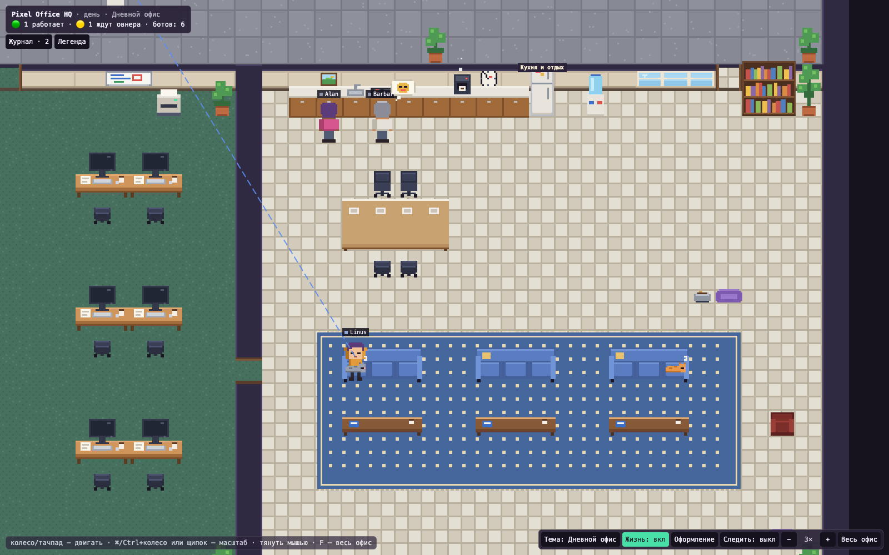
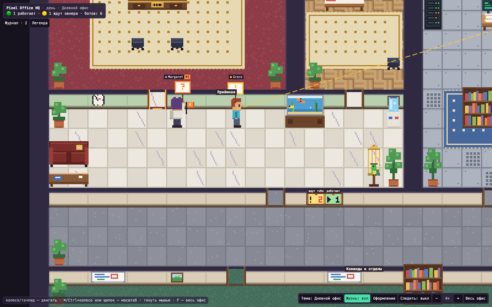
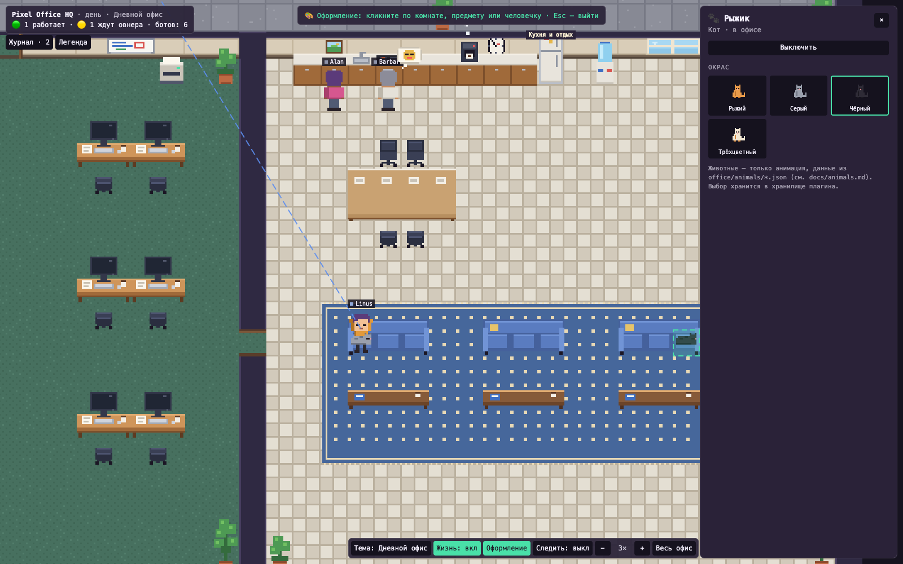
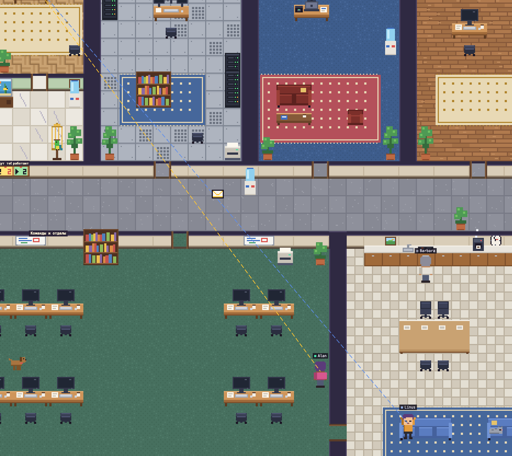

# Pixel Office for Orca


A pixel-art office in an Orca editor tab where your Orca bots are the staff. Every bot has an office
of its own and stands where its **real** status puts it: at its desk while it works, at the CEO's door while it waits
for you, in the lounge when it is done. Mail between bots flies across the office as envelopes. Nothing in the office
calls a model or spends tokens: it only draws what Orca reports, plus some harmless animation.


The interface is in Russian (the office was built for a Russian-speaking team); the code and these docs are in English.

## What you get

- **A whole building from JSON**: CEO office with a reception in front of it, four different C-level offices and a
  mini office, an open space for workers, a corridor, a kitchen and a lounge (`plugin/office/map.json`).
- **Location = status**: working → own desk; waiting or blocked → the CEO's door with a «!»; items in *Needs you* →
  the door with a «?»; done or idle → the sofa or the kitchen. Bots walk there tile by tile (BFS).
- **Employees** («сотрудники»: a bot's dispatched worktrees) sit at desks in the open space, labelled with their
  workspace name. Their **trainees** («стажёры»: subagents an employee runs inside its session, e.g. Claude Code's
  Agent tool) stand as small figures by its desk while they run — read from `orca worktree ps`.
- **A panel per bot**: status and for how long, agent, current chat title and last answer (only while the panel is
  open, never stored), workers, items, and a button to open the bot in Orca.
- **Seating**: bots take free offices at random once and keep them; you can pin anyone to an office (or a worker to a
  desk) from the office itself, swap offices, or unpin.
- **Animals**: cats, a dog and a parrot live in the office. Cats nap on sofas, desks and window sills, rub against a
  bot's legs, watch the fish; the dog follows a bot, lies by the CEO's door, goes to its bowl; the parrot sits in its
  cage, flies to a bookshelf or a bot's shoulder. Animals are **data** (`plugin/office/animals/*.json`): sprites,
  coats and routines; switch each one on or off and pick its coat in «Оформление». See
  [docs/animals.md](docs/animals.md).
- **Resting at home**: a free bot with an office of its own sometimes rests there instead of strolling — on its phone,
  rocking in its chair, feet up, watering a plant, looking out of the window, kicking a ball.
- **Letters to the bot**: an envelope leaves the sender wherever it stands and flies to the recipient wherever it is,
  following it if it walks; the recipient stops to read it, then goes on.
- **«Жизнь» (life)**: idle bots wander the shared rooms — coffee machine, cooler, aquarium, bookshelf, window, sofa —
  and chat in little icon clouds when two of them hang out; bots waiting for you pace the reception holding up a
  sign. Real events always win: a new status sends the bot straight to its real place. Pure animation, zero tokens.
- **«Оформление» (decor)**: click a room to change its floor and walls, click a thing to change its look, click a
  person to change their appearance. Looks come from **skin packs** — JSON files anyone can write.
- **Themes as skin packs**: «Дневной офис» (day office) and «Тёмный лофт» (dark loft), plus day and night from your
  clock, and live details: blinking server racks, fish, coffee steam, a cat, wall clocks with the real time, a notice
  board with the real number of bots waiting for you and at work.

| Life in the lounge | Waiting for you in the reception |
|---|---|
|  |  |

| Animals, and a cat's coat in decor mode | A letter flying to a bot on its way |
|---|---|
|  |  |

| Decor mode | Dark loft at night |
|---|---|
|  |  |

The screenshots use the made-up demo office (`DEMO=1 tools/harness/build.sh`), not real bots. The animation and the
social preview in `docs/media` are recorded from it, the same every time, by `tools/media/make.sh`.

## Install

You need Orca 1.4.259 or newer with plugins turned on.

```sh
git clone <this repository> pixel-office
orca plugin install ./pixel-office/plugin
```

Orca answers `approval_required` and lists what the plugin asks for; re-run the command with the
`--approve <fingerprint>` it prints. For development, load the folder instead so edits reload live:

```sh
orca plugin dev load ./pixel-office/plugin
```

Then open the office: command palette → **Open Pixel Office**, the status bar button «🟢 N работают», or the **+** menu
of the tab bar → **Pixel Office**. Any `*.pixel` file opens as an office.

### What the plugin may do, and why

| Access | Why |
|---|---|
| `trusted-worker` | Its own Node process: sees all bots and runs a fixed, read-only list of `orca` CLI commands |
| `workspace:read` | Which workspaces are bots, and where their homes are |
| `agent:read` | Agent statuses and their changes |
| `workspace:write` | Open the office file, open a bot's home or a worker's workspace |
| `storage:own` | Your choices: looks, theme, pins, seats, life on/off, decor |

The read-only CLI commands are listed in `plugin/src/cli.ts` and checked word for word by tests: bot list, a bot's
workers and items, `worktree ps`, the current chat of an open panel, and the inbox (metadata only: bodies are dropped).
No network, no hooks, no writes to Orca.

## Using it

- **Move around**: wheel or trackpad to pan, ⌘/Ctrl + wheel or pinch to zoom, drag with the mouse, **F** for the
  whole office.
- **Click a bot** for its panel. **📌 Закрепить…** pins it to an office: pick one in the list or click it on the map;
  if someone sits there you are offered a swap. **Открепить** unpins.
- **«Жизнь: вкл/выкл»** (bottom right) turns the routines on or off; the choice is remembered.
- **«Оформление»** (bottom right) enters decor mode: click a room, a thing, a person or an animal, pick a look in the
  panel; it applies at once and is remembered. The panel also lists every animal with an on/off switch. «Так же для всех» applies the look to every thing of that kind. Esc leaves.
- **«Тема: …»** cycles through the theme packs. **Журнал** lists the latest mail between bots, **Легенда** explains
  the colours.
- **Shift+D** shows a debug line (frames, timers, seats).

## Add an animal

One JSON file in `plugin/office/animals/` plus its name in `index.json`: sprites as rows of characters, coats, speed,
rooms and routines. See **[docs/animals.md](docs/animals.md)** and the example `docs/examples/turtle.json`.

## Make your own skins

A skin pack is one JSON file in `plugin/office/skins/` plus its name in `index.json`: a theme (palette, floors), and/or
looks for floors, walls and furniture — recolours of the built-in pictures or your own pixel sprites. No code. See
**[docs/skin-packs.md](docs/skin-packs.md)** and the example `docs/examples/neon.json`.

## Develop

```sh
cd plugin
orca plugin test . && orca plugin check .
npx -p typescript@5 tsc -p . --noEmit
DEMO=1 ../tools/harness/build.sh /tmp/po-demo   # the office outside Orca with made-up bots: http://127.0.0.1:18765/
```

How it is built, stage by stage, with every decision: [docs/design-notes.md](docs/design-notes.md) (in Russian). The
Orca API survey: [docs/orca-api-inventory.md](docs/orca-api-inventory.md). Contributions: [CONTRIBUTING.md](CONTRIBUTING.md).

## License and credits

MIT, see [LICENSE](LICENSE). All code and all pixel art were written for this project; no third-party sprites, fonts or
code are included (labels use the system monospace font). Ideas only, no code, were taken from these MIT/Apache
projects: Oddboro (rooms as JSON stamps, drawing only on change, 16×16 chunks), pixel-agents and openclaw-pixel-agents
(tile map, BFS, zoom and pan), cubicle (one-file palette, the owner's desk).
