# Pixel Office for Orca

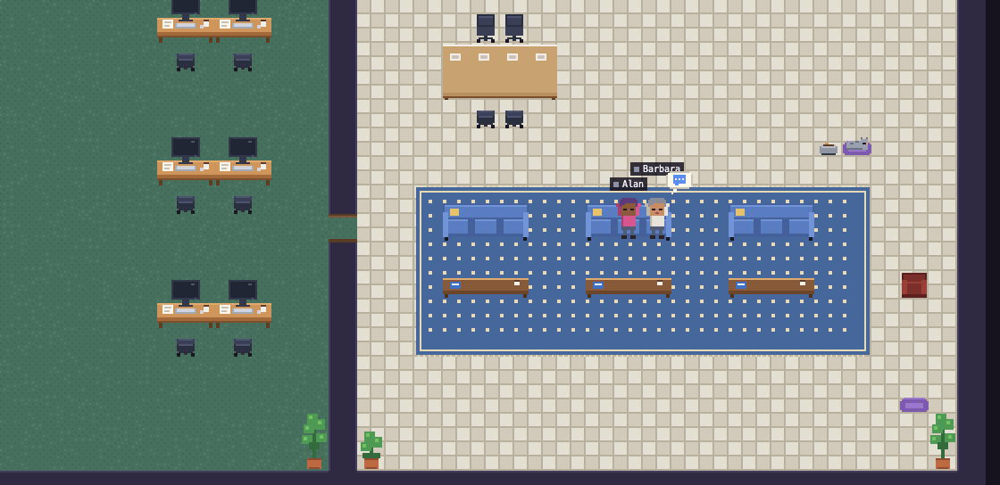

A pixel-art office in an Orca editor tab where your Orca bots are the staff. Every bot has an office
of its own and stands where its **real** status puts it: at its desk while it works, at the CEO's door while it waits
for you, in the lounge when it is done. Mail between bots flies across the office as envelopes. Nothing in the office
calls a model or spends tokens: it only draws what Orca reports, plus some harmless animation.

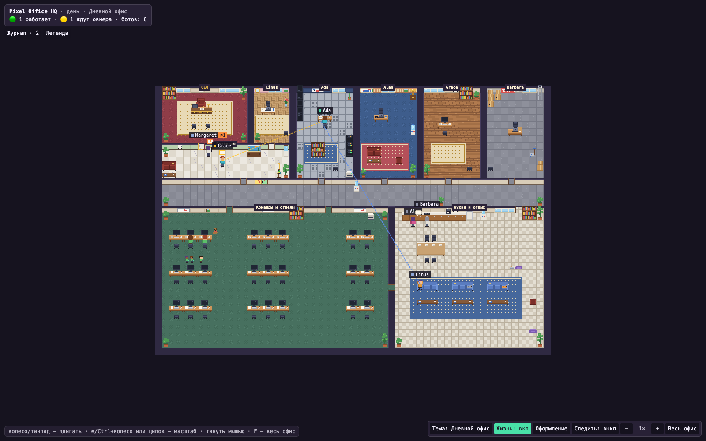

The interface is in Russian (the office was built for a Russian-speaking team); the code and these docs are in English.

## What you get

- **A whole building from JSON**: CEO office with a reception in front of it, C-level offices and a mini office, a QA
  anteroom in front of the CTO's office (the only way to the CTO's chair, past a stand of test phones and tablets), an
  open space of specialists' places for bots below C-level, an open space for workers, a corridor, a kitchen and a
  lounge (`plugin/office/map.json`). Screenshots: [the anteroom](docs/screenshots/anteroom-day.png),
  [the specialists' open space](docs/screenshots/specialists-day.png).
- **Location = status**: working → own desk; waiting or blocked → the CEO's door with a «!»; items in *Needs you* →
  the door with a «?»; done or idle → the sofa or the kitchen. Bots walk there tile by tile (BFS).
- **Employees** («сотрудники»: a bot's dispatched worktrees) sit at desks in the open space, labelled with their
  workspace name. Their **trainees** («стажёры»: subagents an employee runs inside its session, e.g. Claude Code's
  Agent tool) stand as small figures by its desk while they run — read from `orca worktree ps`.
- **A panel per bot**: status and for how long, agent, current chat title and last answer (only while the panel is
  open, never stored), workers, items, and a button to open the bot in Orca.
- **Seating**: bots take free offices at random once and keep them (no office left: a place among the specialists);
  a room may be kept for a role (`"forRole": "QA"`), and a bot whose name starts with «[QA]» goes there by itself; you
  can pin anyone to an office (or a worker to a desk) from the office itself, swap offices, or unpin.
- **Animals**: cats, a dog and a parrot live in the office. Cats nap on sofas, desks and window sills, rub against a
  bot's legs, watch the fish; the dog follows a bot, lies by the CEO's door, goes to its bowl; the parrot sits in its
  cage, flies to a bookshelf or a bot's shoulder. Animals are **data** (`plugin/office/animals/*.json`): sprites,
  coats and routines; switch each one on or off and pick its coat in «Оформление». See
  [docs/animals.md](docs/animals.md).
- **Resting at home**: a free bot with an office of its own sometimes rests there instead of strolling — on its phone,
  rocking in its chair, feet up, watering a plant, looking out of the window, kicking a ball.
- **Letters to the bot**: an envelope leaves the sender wherever it stands and flies to the recipient wherever it is,
  following it if it walks; the recipient stops to read it, then goes on.
- **Every letter between real ends**: any chat of a bot is that bot, any worker (structured ones included) is its
  employee, a Run is the bot whose workers took its tasks. **The CEO's office is you**: what Orca says the owner did
  (an item you changed) flies from the CEO's desk, the chair left empty. **The entrance** (with a «?») is only for an
  outside or unknown address. Orca's own notices that are not yours («Your other chat…») are a journal line, no line
  on the map. [Screenshot](docs/screenshots/mail-owner-day.png).
- **«Жизнь» (life)**: idle bots wander the shared rooms — coffee machine, cooler, aquarium, bookshelf, window, sofa —
  and chat in little icon clouds when two of them hang out; bots waiting for you pace the reception holding up a
  sign. Real events always win: a new status sends the bot straight to its real place. Pure animation, zero tokens.
- **Characters**: dress any bot or employee as a robot, a fox, a deer, a knight, an astronaut… — 17 characters, most
  with 2–4 coats, in every pose the people have; an employee's trainees wear its character too. Characters are
  **data** in skin packs. See [Characters](#characters).
- **«Оформление» (decor)**: click a room to change its floor and walls, click a thing to change its look, click a
  person to change their appearance. Looks come from **skin packs** — JSON files anyone can write.
- **Themes as skin packs**: «Дневной офис» (day office) and «Тёмный лофт» (dark loft), plus day and night from your
  clock, and live details: blinking server racks, fish, coffee steam, a cat, wall clocks with the real time, a notice
  board with the real number of bots waiting for you and at work.
- **Night light**: at night the office darkens, a room with someone in it switches its light on, lamps light what is
  round them (never through a wall), screens glow while their bot works, the microwave hums while a bot warms its
  lunch, and the city behind the windows lives. See [At night](#at-night).

| Life in the lounge | Waiting for you in the reception |
|---|---|
|  |  |

| Animals, and a cat's coat in decor mode | A letter flying to a bot on its way |
|---|---|
|  |  |

| Decor mode | Dark loft at night |
|---|---|
| 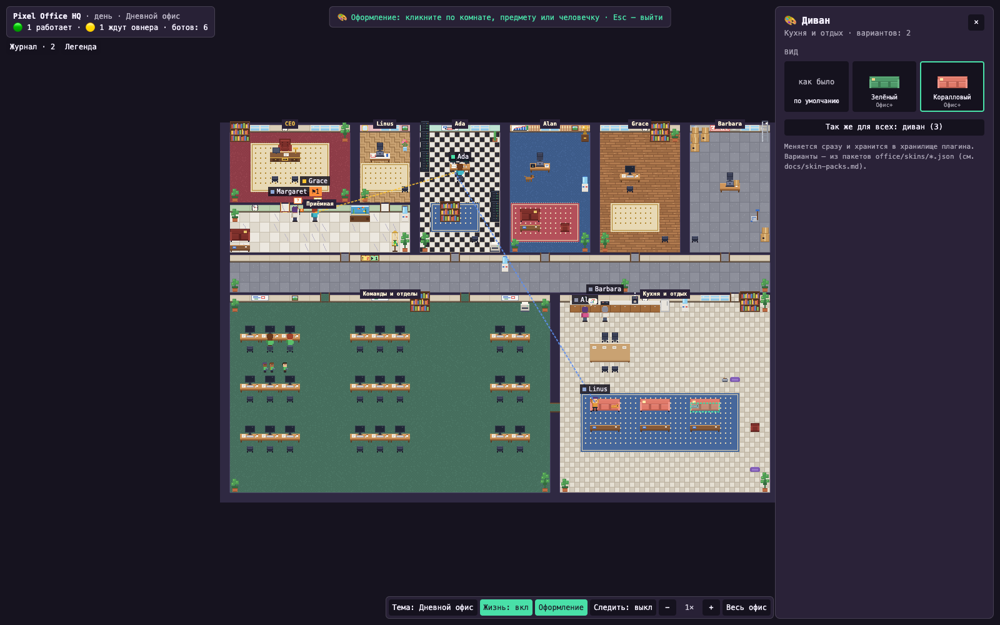 | 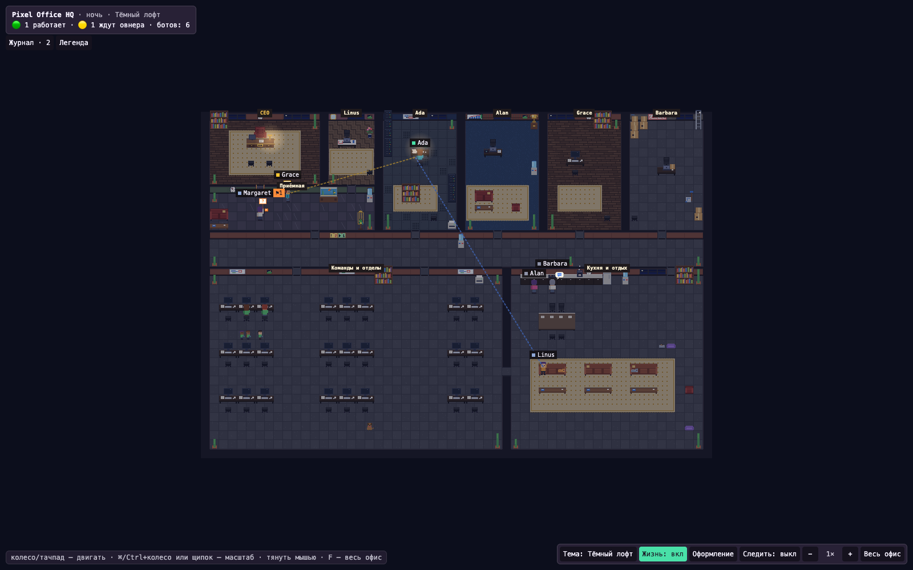 |

## At night

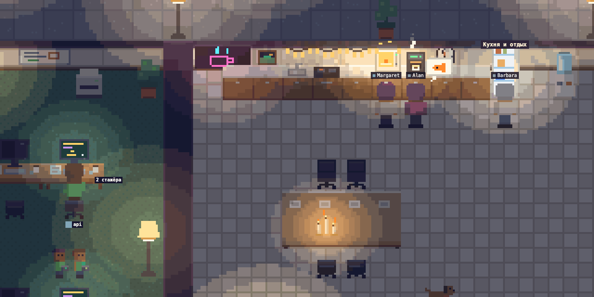

From the evening on (by your clock) the office darkens. Nothing here costs a token: it is only pictures.

- **Light by rooms**: the night is an even, cold blue-violet. A room where someone is (a bot, an employee, a trainee)
  switches its light on — the whole room, evenly, fading in over ~0.7 s; empty rooms stay dark; the hall is dimly lit.
- **Lamps light what is round them**: a desk lamp its desk, a wall lamp its wall and the floor under it, a floor lamp by
  the sofas the sofa and its table. Walls stop the light; a doorway lets through only a little. Light is not painted
  on top: it lifts the dark off the scene, so floors, furniture and people keep their own colours, and nothing is ever
  brighter than by day, even where two lamps meet. Lamps stand where they would in a real office: desk lamps on desks,
  wall lamps on walls, a floor lamp by the sofas, in the reception and in the CEO's office.
- **Screens**: while a bot or an employee works, its screen glows and shows something alive — code, logs by the
  server racks or for a CTO, charts for sales and money, a chat for an assistant — beside the bot's head, never
  behind it. While its owner is away it shows a screensaver; a desk nobody owns stays dark.
- **Kitchen**: candles with trembling flames, a garland, a neon cup. The microwave lights up and hums while a bot warms
  its lunch, the coffee machine lights up while it pours, the fridge glows inside while it stands open.
- **Windows**: those out of the building show a deep blue sky with stars over a city that lives — houses' windows go
  out and on at their own times, stars twinkle, now and then a car drives past or a plane flies over. Whatever stands
  in front of a window covers its lights. A window into the next room (the kitchen's, into the hall) is plain glass.
- **Lights are furniture**: click one in «Оформление» to change its look or switch it off (kept after a restart). More
  looks come as a skin pack with their own colour of light: `plugin/office/skins/lights.json`, see
  [docs/skin-packs.md](docs/skin-packs.md#lights).
- **Cheap**: the light is computed once per change (the hour, a lamp switched, a screen on or off, a room's light
  fading), not every frame; flames, screens, the microwave and the city move on the office's one animation timer.

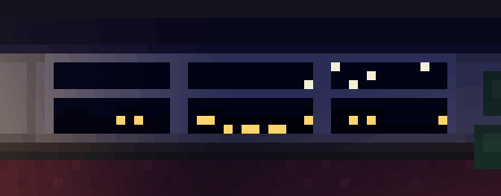

| «Команды и отделы» at night | The kitchen and the sofas |
|---|---|
| 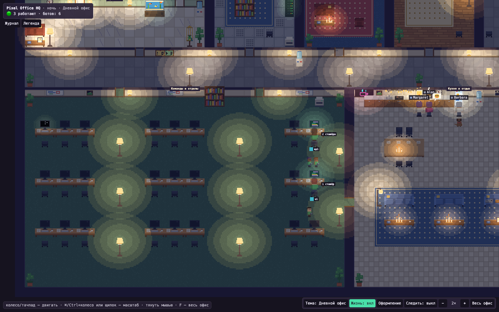 | 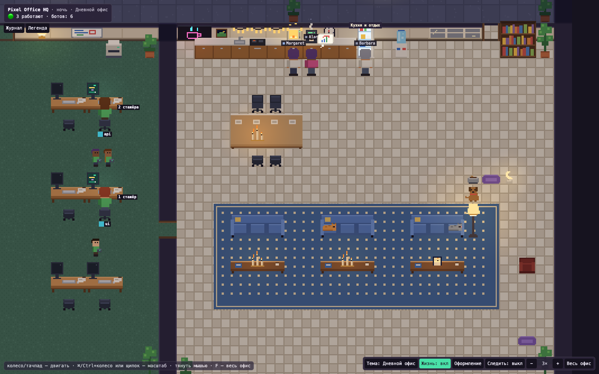 |

| The CEO's office and the reception | The offices of the C-level |
|---|---|
| 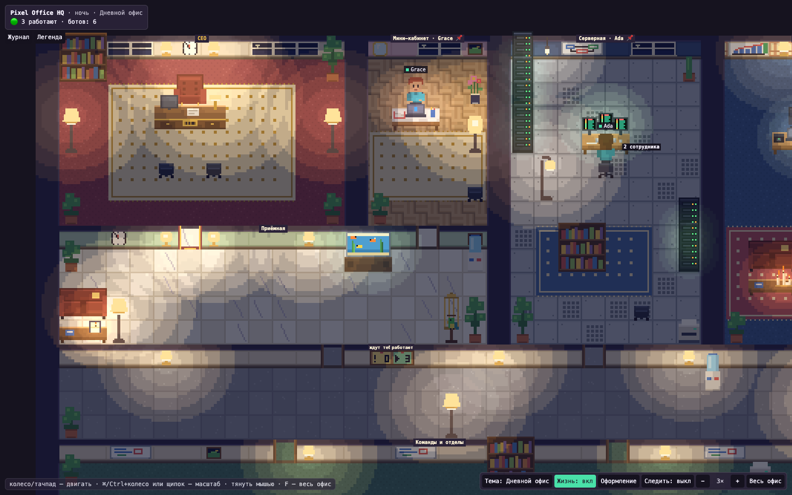 | 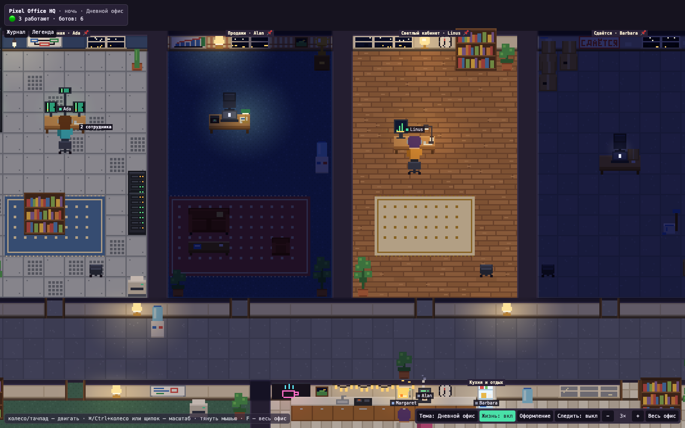 |

| Two lamps by the CEO's door, at night | The same by day |
|---|---|
| 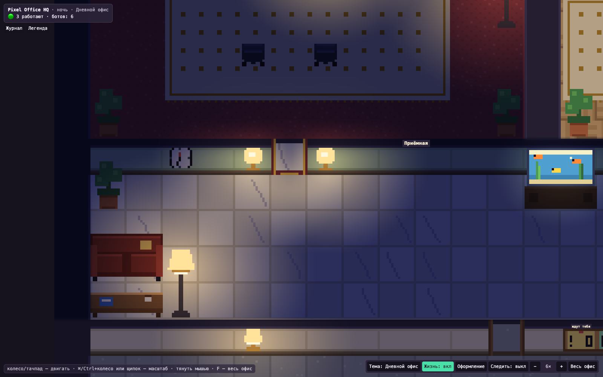 | 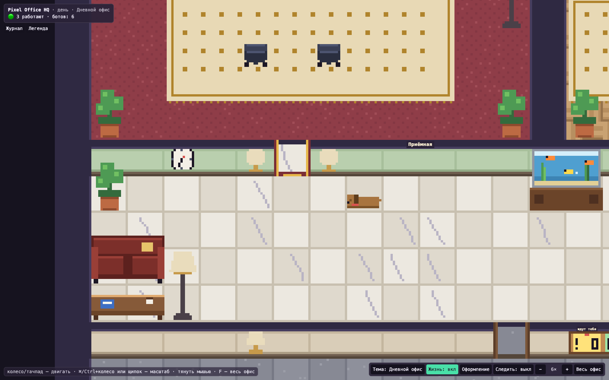 |

| A lamp by the wall: the hall behind it stays dim | «Тёмный лофт» at night |
|---|---|
| 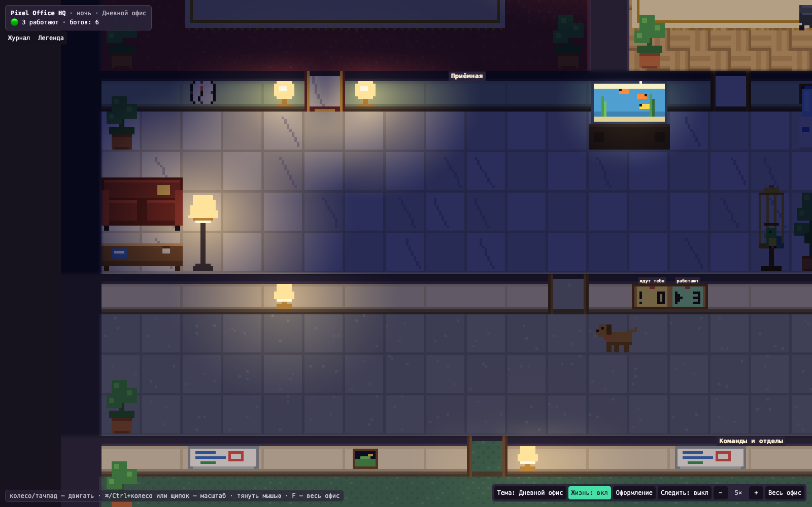 | 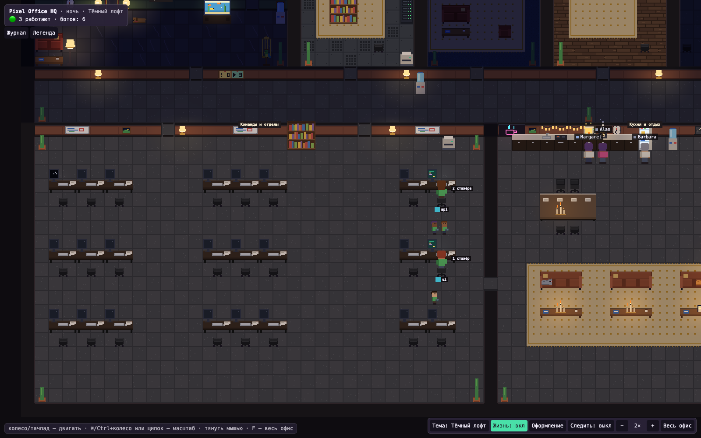 |

Fixed on the way: the [CEO's bookshelf](docs/screenshots/bookshelf-after.png) in front of the window keeps its books
(before, [the city's lights showed on them](docs/screenshots/bookshelf-before.png)); the top monitor of the
[server room desk](docs/screenshots/server-monitor-after.png) stands on a pole ([before](docs/screenshots/server-monitor-before.png));
the [kitchen window into the hall](docs/screenshots/kitchen-window-after.png) is plain glass
([before](docs/screenshots/kitchen-window-before.png)).

The screenshots use the made-up demo office (`DEMO=1 tools/harness/build.sh`), not real bots. The animation and the
social preview in `docs/media` are recorded from it, the same every time, by `tools/media/make.sh`.

## Install

You need Orca 1.4.259 or newer with plugins turned on.

```sh
git clone <this repository> pixel-office
orca plugin install ./pixel-office/plugin
```

Orca answers `approval_required` and lists what the plugin asks for; re-run the command with the
`--approve <fingerprint>` it prints. For development, load the folder instead so edits reload live:

```sh
orca plugin dev load ./pixel-office/plugin
```

Then open the office: command palette → **Open Pixel Office**, the status bar button «🟢 N работают», or the **+** menu
of the tab bar → **Pixel Office**. Any `*.pixel` file opens as an office.

### What the plugin may do, and why

| Access | Why |
|---|---|
| `trusted-worker` | Its own Node process: sees all bots and runs a fixed, read-only list of `orca` CLI commands |
| `workspace:read` | Which workspaces are bots, and where their homes are |
| `agent:read` | Agent statuses and their changes |
| `workspace:write` | Open the office file, open a bot's home or a worker's workspace |
| `storage:own` | Your choices: looks, theme, pins, seats, life on/off, decor |

The read-only CLI commands are listed in `plugin/src/cli.ts` and checked word for word by tests: bot list, a bot's
workers and items, `worktree ps`, a bot's chats (the current one for an open panel; only the ids, to place mail),
the inbox (metadata only: bodies are dropped), `worker-list` and a Run's task list (only the ids).
No network, no hooks, no writes to Orca.

## Using it

- **Move around**: wheel or trackpad to pan, ⌘/Ctrl + wheel or pinch to zoom, drag with the mouse, **F** for the
  whole office.
- **Click a bot** for its panel. **📌 Закрепить…** pins it to an office: pick one in the list or click it on the map;
  if someone sits there you are offered a swap. **Открепить** unpins.
- **«Жизнь: вкл/выкл»** (bottom right) turns the routines on or off; the choice is remembered.
- **«Оформление»** (bottom right) enters decor mode: click a room, a thing, a person or an animal, pick a look in the
  panel; it applies at once and is remembered. The panel also lists every animal with an on/off switch. «Так же для всех» applies the look to every thing of that kind. Esc leaves.
- **«Тема: …»** cycles through the theme packs. **Журнал** lists the latest mail between bots, **Легенда** explains
  the colours.
- **Shift+D** shows a debug line (frames, timers, seats).

## Examples

Four more buildings to copy or to look at: a garage startup, an orbital station, a corporation of 12 executives and 36
employees, a castle. Each is a `map.json` in the same format as the shipped one, with made-up bots for the harness;
how to switch to one is in [examples/offices](examples/offices/README.md).

| Garage | Orbital station |
|---|---|
| 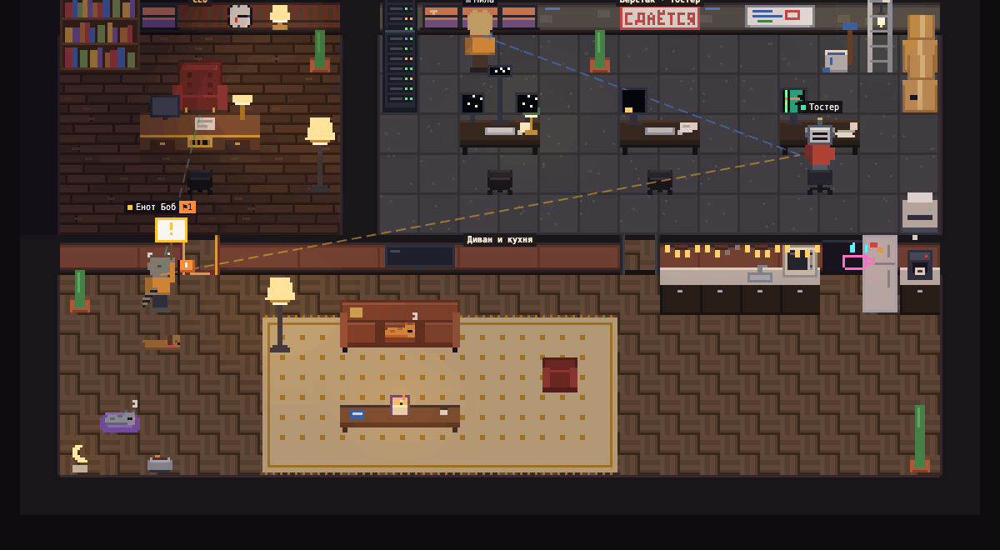 | 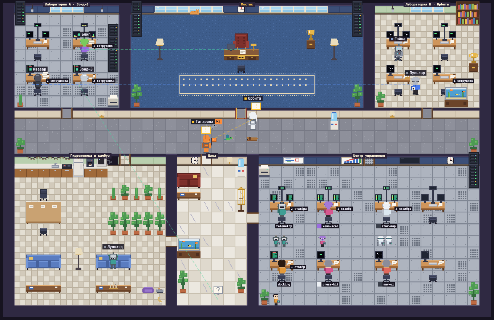 |
| **Corporation** | **Castle** |
| 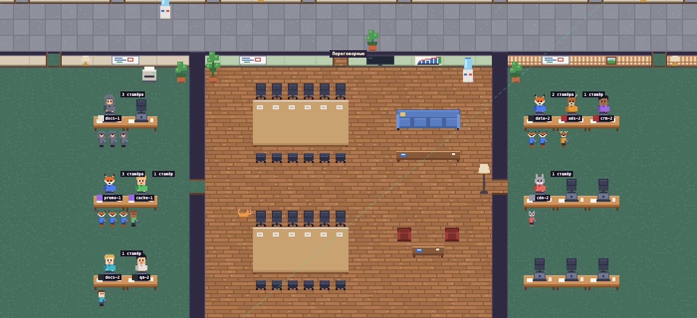 | 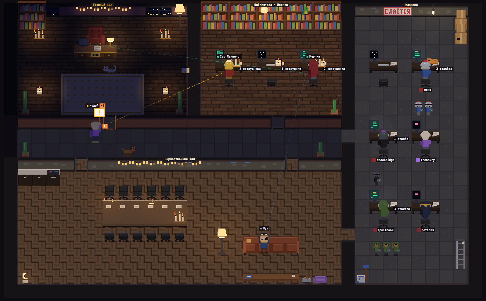 |

## Characters

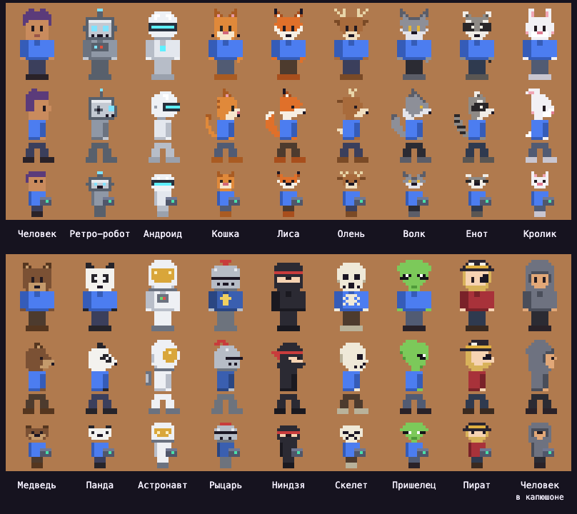

Open a bot's panel → **Внешность** (or click a person in «Оформление»; employees have the same button in their panel)
and pick a **Персонаж** and its **Окрас**. The choice is kept in the plugin storage and survives restarts.

| Pack | Characters and coats |
|---|---|
| Роботы (`robots.json`) | Ретро-робот with an antenna (жестяной, красный, бирюзовый) · Андроид (белый, чёрный, хром) |
| Фурри (`furries.json`) | Кошка (рыжая, серая, чёрная) · Лиса (рыжая, песец, чернобурка) · Олень (благородный, пятнистый, северный) · Волк (серый, чёрный, полярный) · Енот (полосатый, рыжеватый) · Кролик (белый, шоколадный, серый) · Медведь (бурый, белый, гималайский) · Панда |
| Костюмы (`costumes.json`) | Астронавт (белый, оранжевый) · Рыцарь (стальной, золотой, чёрный) · Ниндзя (чёрный, ночной, алый) · Скелет (костяной, древний) · Пришелец (зелёный, серый, фиолетовый) · Пират (красный, синий, чёрный камзол) · Человек в капюшоне (серый, лесной, багровый, чёрный) |

Every character walks, types, waits with the sign, reads letters and does every rest pose: the office draws the poses,
a character only brings its heads (front, back, side, asleep), a small head for trainees, a tail or a backpack, a chest
and the colours of its body. Ears, antlers and plumes stay inside the figure, so the status sign and the name badge
above it stay readable. Furries wear the shirt you pick; a pirate keeps your skin and hair colour. Make your own:
**[docs/characters.md](docs/characters.md)**, example `docs/examples/frog.json`.

## Add an animal

One JSON file in `plugin/office/animals/` plus its name in `index.json`: sprites as rows of characters, coats, speed,
rooms and routines. See **[docs/animals.md](docs/animals.md)** and the example `docs/examples/turtle.json`.

## Make your own skins

A skin pack is one JSON file in `plugin/office/skins/` plus its name in `index.json`: a theme (palette, floors), and/or
looks for floors, walls and furniture — recolours of the built-in pictures or your own pixel sprites — and/or
characters for people ([docs/characters.md](docs/characters.md)). No code. See
**[docs/skin-packs.md](docs/skin-packs.md)** and the example `docs/examples/neon.json`.

## Develop

```sh
cd plugin
orca plugin test . && orca plugin check .
npx -p typescript@5 tsc -p . --noEmit
DEMO=1 ../tools/harness/build.sh /tmp/po-demo   # the office outside Orca with made-up bots: http://127.0.0.1:18765/
```

How it is built, stage by stage, with every decision: [docs/design-notes.md](docs/design-notes.md) (in Russian). The
Orca API survey: [docs/orca-api-inventory.md](docs/orca-api-inventory.md). Contributions: [CONTRIBUTING.md](CONTRIBUTING.md).

## License and credits

MIT, see [LICENSE](LICENSE). All code and all pixel art were written for this project; no third-party sprites, fonts or
code are included (labels use the system monospace font). Ideas only, no code, were taken from these MIT/Apache
projects: Oddboro (rooms as JSON stamps, drawing only on change, 16×16 chunks), pixel-agents and openclaw-pixel-agents
(tile map, BFS, zoom and pan), cubicle (one-file palette, the owner's desk).
