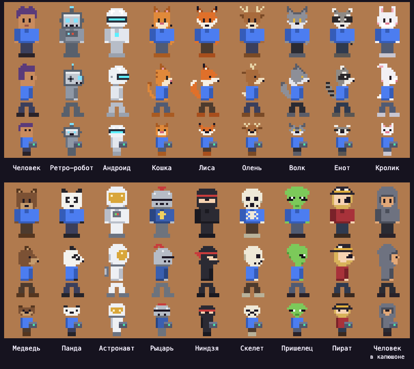

# How to make your own character

A character is a skin for a person: a robot, a fox, a knight. The owner puts it on any bot or employee in «Внешность»
(or by clicking the person in «Оформление»); an employee's trainees wear it too, small. Characters live in
[skin packs](skin-packs.md), in a `characters` list next to (or instead of) `theme` and `variants`.



A character does **not** redraw the poses. The office still draws walking, standing, waiting with the sign, typing at the
desk, reading a letter, the sofa and every rest pose (phone, feet up, rocking the chair, watering the plant, at the window,
the ball) itself, frame by frame. A character gives only what makes it someone else:

- **heads**: from the front, the back and the side (and, if you like, asleep on the sofa);
- **a small head** for trainees;
- optionally **a tail** (or anything else on the back: a backpack, a ribbon) and **a chest** (a panel, an emblem);
- **the colours of the body**: hands, clothes, shoes.

So every character has every pose and every frame for free, and the status signs, name badges and bubbles above the
head stay where they are. Shipped: `plugin/office/skins/robots.json`, `furries.json` and `costumes.json`, drawn by
`tools/make_characters.py` (you can write rows by hand). A small, complete example that the tests load:
[`docs/examples/frog.json`](examples/frog.json).

## Install

Like any skin pack: put the file in `plugin/office/skins/`, add its name to `index.json`, reopen the office tab. Mistakes
show up in the HUD and line by line with **Shift+D**; a broken character is skipped, the rest of the pack still loads.

## The figure and where the parts go

A person is 16 × 26 art pixels, feet on the bottom row. Every part is rows of characters (one per pixel, `.` and space
are clear) and sits at a fixed place, its **anchor**:

```
x: 0123456789012345
 0 ..############..   head: 12 × 12 at x 2, y 0 (this box)
 1 ..############..     · the person's face is x 4..11, y 4..11 (head columns 2..9, rows 4..11)
 …                      · its eyes are at head columns 4 and 7, rows 7..8
11 ..############..     · ears, horns, a plume: rows 1..3 (row 0 is cut off while walking:
12 ....########....       the figure bobs up a pixel)
 …     body            · the shirt is x 4..11, y 12..18 facing us; arms x 2..3 and 12..13
19 .....######.....     · trousers y 19..23, shoes y 24..25
25 ....########....
```

| Part | Size, anchor | Drawn |
|---|---|---|
| `head.front` | 12 × 12 at (2, 0) | facing us: walking, standing, waiting, typing, reading, on the chair, the ball |
| `head.back` | 12 × 12 at (2, 0) | back to us: walking away, typing at a desk seen from behind, at the window |
| `head.side` | 12 × 12 at (2, 0), **facing right** | walking sideways, watering the plant; mirrored for the left; moved 3 px left when the feet are on the desk |
| `head.sleep` | 12 × 12 at (2, 0), optional | on the sofa (eyes closed); without it, `head.front` |
| `mini` | 10 × 7 at (0, 0) of the 10 × 16 trainee | trainees, by their employee's desk |
| `tail.side` | any size, your `x`, `y` | behind the body, seen from the side (the figure faces right) |
| `tail.back` | any size, your `x`, `y` | over the body, seen from behind |
| `tail.front` | any size, your `x`, `y` | behind the body, facing us: a tip peeking out |
| `chest` | any size, your `x`, `y` | over the shirt, facing us |

Heads are rows only (`"front": ["…12 rows of 12…"]`); tails and the chest say where they sit:
`{ "x": 1, "y": 10, "rows": ["dd...", "fd...", "…"] }`. Every part must fit in the figure (16 × 26; the trainee's head in
10 × 7). Keep tails low and to the side and heads within their box: whatever is above the figure belongs to the status
sign and the name badge.

## Colours

```json
"legend": { "f": "$fur", "d": "$furDark", "w": "$belly", "e": "@eye", "s": "%skin" },
"body": { "hands": "$fur", "shoes": "$furDark" },
"coats": [
  { "id": "red", "name": "Рыжая", "colors": { "fur": "#e0702a", "furDark": "#a84e1c", "belly": "#f6efe4" } },
  { "id": "arctic", "name": "Песец", "colors": { "fur": "#e9edf2", "furDark": "#b9c0cc", "belly": "#ffffff" } }
]
```

- **`legend`** maps a character to a colour:
  - `"#rrggbb"` — a fixed colour;
  - `"@eye"`, `"@ink"`… — a palette entry, so it follows the theme ([palette entries](skin-packs.md#palette-entries));
  - `"$fur"` — a colour of the chosen **coat**;
  - `"%skin"`, `"%hair"`, `"%shirt"`, `"%shade"`, `"%pants"` — the colours the owner picked in «Внешность» (a pirate keeps
    the owner's skin and hair under the hat).
- **`coats`**: 1 to 6. Every coat names the same colours; the first is the default. The owner picks one in «Внешность»
  («Окрас»).
- **`body`**: the colours of the body the office draws, with the same kinds of values:
  `hands` (also the arms' ends), `shirt` and `shade` (the clothes and their shadow), `pants`, `shoes`. Leave one out and
  it stays the owner's choice: a fox in the owner's shirt, a robot painted all over.

The editor shows only the owner's colours the character still uses (a fox has no hair colour to pick; a pirate does).

## The whole character

```json
{
  "format": 1,
  "id": "pond",
  "name": "Пруд",
  "author": "you",
  "license": "MIT",
  "characters": [
    {
      "id": "frog",
      "name": "Лягушка",
      "group": "Пруд",
      "coats": [{ "id": "green", "name": "Зелёная", "colors": { "skin": "#6dbb4a", "dark": "#4a8a32", "belly": "#e6efc0" } }],
      "legend": { "g": "$skin", "d": "$dark", "w": "$belly", "E": "@eye", "m": "$dark" },
      "body": { "hands": "$skin", "shoes": "$dark" },
      "head": { "front": ["…"], "back": ["…"], "side": ["…"], "sleep": ["…"] },
      "mini": ["…"]
    }
  ]
}
```

| Field | Meaning |
|---|---|
| `id`, `name` | `a-z`, `0-9`, `-`; the name in «Внешность». The full id is `<pack>:<id>`. |
| `group` | The heading it is listed under in «Внешность» («Роботы», «Фурри»…). |
| `coats`, `legend`, `body` | Colours, above. |
| `head`, `mini` | Required. |
| `tail`, `chest` | Optional. |

## Where the choice lives

In the plugin storage of the owner's Orca, with the rest of the look: `appearance:<bot key>` (or `appearance:w:<employee
id>`) holds `character: "<pack>:<id>"` and `coat: "<coat id>"`. A character whose pack is gone draws as a person again;
the choice is kept, so it comes back with the pack.

## Checklist

- Your own art, a licence in `license` (the shipped ones are MIT).
- Try it in both themes, by day and by night (`?hour=22` in the harness), and on a dark and a light floor.
- Nothing that looks like a status sign: the «!» and «?» belong to the status.
- `cd plugin && orca plugin test .` — the shipped characters and the frog are drawn in every pose by the tests; the
  gallery (`tools/media/gallery.ts`) shows them all.
