# Pixel Office: заметки о разработке

Подробная история и устройство по этапам (v2–v5). Для знакомства с проектом — [README](../README.md).

Плагин Orca **Pixel Office** (`local.pixel-office` 0.6.0, папка [`plugin/`](../plugin/)). Это большой пиксельный офис
во вкладке основной области. В нём есть кабинет CEO с пустым креслом и приёмная перед ним, мини-кабинет в приёмной,
четыре разных кабинета C-Level, open space для команд, коридор, кухня и диван. У каждого Orca-бота свой кабинет. Бот
стоит там, куда его ставит **реальный** статус в Orca, и при смене статуса идёт туда по тайлам.

Готовы все этапы:

1. движок большого офиса;
2. клик по боту → панель;
3. реальные взаимодействия;
4. скины и живость;
5. v4: кабинеты C-Level и приёмная, закрепление мест, прикольчики (см. «v4» ниже);
6. v5: «Жизнь» без токенов, скины всего («Оформление», пакеты скинов), подготовка к опенсорсу (см. «v5»).

Скриншоты этапов в репозиторий не входят; в README — снимки демо-офиса (`DEMO=1 tools/harness/build.sh`).

## Как открыть

- Палитра команд (поиск Orca): **Open Pixel Office**. Команда создаёт, если его ещё нет, файл
  `.pixel-office/office.pixel` в фокусном воркспейсе и открывает его вкладкой. Папка `.pixel-office`
  сама себя исключает из git.
- Кнопка в статус-баре «🟢 N работают» (или «🟢 N · 🟡 M ждут») запускает ту же команду.
- Меню **+** у вкладок → **Pixel Office**: безымянный `.pixel`. Любой файл `*.pixel` открывается в офисе, его текст не
  используется.

## Что умеет (этап 1)

- **Камера.**
  - Пан: колесо или тачпад, перетаскивание мышью, стрелки.
  - Зум: ⌘/Ctrl + колесо, щипок на тачпаде, кнопки «− / +», клавиши `+`/`-`. Точка под курсором остаётся на месте.
  - Весь офис в экран: кнопка «Весь офис», клавиша `F` или `0`.
  - Масштаб только целый (1–12 device-пикселей на арт-пиксель), так что пиксели остаются квадратными.
  - Камера не уходит за здание дальше полей.
- **Боты.**
  - Бейдж с именем и цветом статуса. Бейджи соседних ботов не перекрываются.
  - Подсказка при наведении: имя, роль, агент (claude/codex/…), статус и сколько в нём, число чатов, место.
- **Локация = статус**: см. таблицу ниже. Ходьба — поиск в ширину (BFS) по проходимым тайлам, через двери и в обход
  мебели. Боты ходят только когда Orca сообщает новый статус. Новый бот появляется на своём месте сразу.
- **Рисуем только при изменениях.**
  - Кадр рисуется по dirty-флагу: несколько изменений дают один кадр через одноразовый `requestAnimationFrame`.
    Постоянного цикла `requestAnimationFrame` нет.
  - Здание (пол, стены, двери, окна, ковры) запекается в битмапы по чанкам 16×16 тайлов. Чанк создаётся при
    первом появлении в кадре, дальше копируются только видимые.
  - Мебель и боты — кэшированные спрайты, отсортированные по глубине. Всё вне экрана пропускается.
- **Один таймер анимаций** (~12 Гц, `engine/scheduler.ts`). Он работает, только пока кто-то идёт, печатает за столом
  или ждёт с пузырём «!»/«?». Когда все отдыхают, таймер останавливается сам и кадров нет.
- **Графика.** Весь арт нарисован в коде прямоугольниками в одной палитре (`plugin/editor/palette.ts`).
  - 7 видов пола.
  - Стены с видимой гранью и плинтусом, двери; дверь CEO в золотой раме. С v4 у комнаты свой цвет стены.
  - Окна, доски, ТВ, часы, картины.
  - Столы с мониторами: экран горит, когда бот за столом работает.
  - Стол CEO с пустым кожаным креслом.
  - Диваны, кухня (столешницы, мойка, плита, кофемашина, холодильник), кулер, принтер, книжные полки, растения,
    ковры. Мебель кабинетов v4 — в разделе «v4».
  - Персонажи: 4 кадра ходьбы в 4 стороны, сидя за столом (2 кадра печати), «ждёт» (рука вверх, пузырь), «закончил»
    (на диване, руки за головой), «у кухни» (с кружкой).
  - Внешность бота детерминированно выводится из его ключа.
- Статус-бар и команда «Open Pixel Office» те же, что в v2.
- Скрытая отладка: **Shift+D** во вкладке. Показывает кадры, тики, состояние таймеров (и «живности»), число чанков,
  сколько мест закреплено и запомнено.

## Этап 2: панель бота, сотрудники, Needs you

- **Клик по человечку** открывает панель справа, внутри вкладки, а не модальным окном. Закрывается крестиком, Esc
  или кликом по пустому месту. Клик по другому боту переключает панель на него.
- **Что в панели:**
  - имя и роль: роль из имени `[роль] Имя`;
  - агент (claude/codex/…) из `agents.list`, иначе из `orca bot list`;
  - статус и время в нём («работает · 12 мин») из `stateStartedAt`; число активных сессий;
  - **текущий чат**: title и последний ответ (`lastSaid`, до 280 символов) открытого чата с самой свежей
    активностью. Читается только когда открыта панель этого бота (и по кнопке ↻). Нигде не хранится и не
    логируется, при закрытии панели выбрасывается;
  - **сотрудники (воркеры)**: имя воркспейса, агент, статус. Живые (working/blocked/waiting) идут первыми;
  - **items**: счётчики по статусам, Needs you выделен, под ним — заголовки items в Needs you. Описания и
    комментарии items не читаются;
  - кнопка **«Открыть бота в Orca»** (`workspace.open`): показывает дом бота. Открыть *конкретный* чат API Orca не
    позволяет: id чата в `orca bot chats` есть, но его принимает только пишущая `orchestration send --chat`, а
    host API такого метода не имеет.
- **Чего нет в данных**, то в панели написано «нет данных». Это касается CLI, который недоступен или не ответил за
  15 с, отсутствующего поля и бота, которого CLI не знает. Офис при этом продолжает работать.
- **Сотрудники в офисе.** У стола бота, у которого есть живые воркеры, стоят маленькие фигурки с ноутбуками: до 3, дальше
  «+N». Огонёк ноутбука — цвет статуса воркера. Данные — `orca bot work list` вместе с `orca worktree ps` (по
  `bot`/`parent`); дом самого бота не считается.
- **Needs you.** Если у бота есть items в Needs you, рядом с головой стоит оранжевый флажок, а в бейдже — «⚑N».
  Число берётся из `counts.needs_you` в `orca bot item list`.

### Доступ к Orca CLI (решение CTO на этапе 2)

В host API 1.10 нет воркеров бота, items и чатов. CTO разрешил trusted-worker читать их через `orca` CLI —
это API самого Orca, а не свои хуки — **строго read-only и по белому списку** (`plugin/src/cli.ts`):

| Команда | Что берём | Когда |
|---|---|---|
| `orca bot list --json` | id бота, агент | при чтении «экстра» |
| `orca bot work list --bot <имя> --json` | воркеры: id, имя, «agent working/idle» | при чтении «экстра» |
| `orca bot item list --bot <имя> --json` | счётчики по статусам, заголовки Needs you | при чтении «экстра» |
| `orca worktree ps --json` | у воркспейсов `bot`, `parent`, агент и статус | при чтении «экстра» |
| `orca bot chats --bot <имя> --json` | title и `lastSaid` (≤280) текущего чата | только по клику, для открытой панели; не хранится |
| то же, для почты | только `id` чатов (title и тексты не берутся) | раз в 10 мин, или через минуту, если в почте чат, которого нет в `worktree ps` |
| `orca orchestration inbox --json --limit 50` | id, from, to, type, subject (≤80); body и payload выбрасываются | раз в 15 с при открытой вкладке; по событию |
| `orca orchestration worker-list --json` | dispatchId, taskId, terminal, workspace, state, outcome, liveness | вместе с почтой, не чаще раза в 30 с |
| `orca orchestration task-list --run <run_…> --json` | только `id` задач Run | для Run, чей бот неизвестен: не больше 3 за чтение, каждую не чаще раза в 10 мин |

- **Белый список.** Разрешены ровно эти списки аргументов, слово в слово. Всё остальное отклоняется ещё до запуска
  процесса: пишущие команды (send, reply, item set, create…), лишние флаги (`--all`, `--pairing-code`), имя бота,
  похожее на флаг (`-…`), переводы строк. Это проверяют тесты.
- **Запуск.**
  - `execFile` с массивом аргументов, без shell;
  - таймаут 15 с, `maxBuffer` 8 MiB;
  - бинарник: фиксированный `/Applications/Orca.app/Contents/Resources/bin/orca`, иначе абсолютный
    `ORCA_CLI_COMMAND`, иначе `orca` из PATH. Какой взят, пишется в лог плагина один раз (только путь).
- **Когда читаем.**
  - Вкладка спрашивает воркер при открытии и раз в 30 с, пока открыта. Воркер читает CLI, только если его кэш
    старше 30 с.
  - Событие агента (бота или его воркера) перечитывает данные с дебаунсом 3 с, не чаще раза в 10 с, и только пока
    вкладка открыта (запрос за последние 75 с).
  - Без открытой вкладки CLI не запускается.
- **Приватность.** Текст чата идёт только в открытую панель. Воркер его не кэширует, не логирует и не пишет в
  storage или файлы. Из `worktree ps` берутся только `bot`/`parent`/агент/статус (поле `lastAssistantMessage` не
  читается).

## Этап 3: реальные взаимодействия

Всё ниже рисуется только по данным Orca. Болтовни, выдуманных встреч и автономных прогулок нет.

- **Конверт.** Письмо между ботами (`orchestration inbox`) летит по дуге от отправителя к адресату. Цвет — тип:
  handoff синий, question жёлтый, status зелёный, worker_done фиолетовый, escalation красный, прочие серые.
  Heartbeat-письма не показываются: это служебный пинг, а не взаимодействие.
- **Куда летит.**
  - Бот — к его столу (нет стола — к самому боту).
  - Воркер бота (`term_…`, `dispatch:ctx_…`) — к его сотруднику у стола бота.
  - `run:…` — к координатору этой Run. Кто он, выводится из самой почты: координатор пишет в `dispatch:` воркера,
    воркер пишет в `run:`.
  - Всё остальное (другой компьютер, неизвестный dispatch) — ко **входу**: место `entrance` в правом конце
    коридора. С v7.1 овнер — кабинет CEO, а служебное от Orca — только журнал (см. «v7.1: адреса писем»).
- **Линия.** Между теми, кто переписывался, остаётся пунктир цвета последнего письма. Он бледнеет за
  `LINE_FADE_MS` = 10 минут (`plugin/engine/fx.ts`) и исчезает. Переписка в обе стороны — одна линия. Отдельного
  таймера у затухания нет: кадр перерисовывается по 15-секундному опросу.
- **Журнал офиса** (кнопка «Журнал» слева сверху): последние 50 писем в виде «время · кто → кому · тип · тема».
  Тема обрезана до 80 символов, тело письма не читается и не хранится. Клик по записи ведёт камеру к отправителю.
- **Время.** Orca отдаёт время письма только вместе с полным телом (`inbox --full`), поэтому «время» — это когда
  офис впервые увидел письмо. Письма, которые были до открытия вкладки, идут в журнал с пометкой «до открытия»:
  без анимации и без линии.
- **Сотрудники.** Воркер появился (событие `workspace.created` → перечитать `bot work list`/`worktree ps`) — у стола
  бота «выпрыгивает» новая фигурка. Воркер закончил — она бледнеет. Воркер исчез из списка (release, удаление) —
  она тает и пропадает. Живые стоят первыми, дальше «+N».
- **Знаки над ботом** и **куда он идёт**: таблица ниже.
- **«Следить»** (кнопка у зума, по умолчанию выкл). Камера плавно едет к последнему реальному событию: к адресату
  нового письма или к боту, у которого сменился статус. Любой ввод овнера (колесо, перетаскивание, зум,
  кнопки, клавиши, клик по журналу) выключает слежение, и кнопка это показывает.

### Источник событий (шаг 0)

`orca orchestration inbox` без `--terminal`/`--run` показывает **все** почтовые ящики этой Orca: from, to, type,
subject, id, handled, новые сверху. Межботовая картина есть.

- Фильтра `since` нет, только `--limit`. Берём `--limit 50`, дубли гасим по id.
- Времени в кратком виде нет (см. выше).
- Белый список дополнен ровно двумя формами (решение CTO на этапе 3):
  - `orca orchestration inbox --json --limit 50`. Из ответа берутся id/from/to/type и subject (≤80 символов).
    Поля `body` (превью тела) и `payload` выбрасываются при разборе; это проверяет тест.
  - `orca orchestration worker-list --json`. Берутся только dispatchId, terminal, workspace, state, outcome и
    liveness; нужен, чтобы понять, чей воркер стоит за адресом `dispatch:ctx_…`.
- Опрос: вкладка спрашивает раз в 15 с, пока открыта. События агентов перечитывают почту с дебаунсом 2 с, не
  чаще раза в 15 с и только пока вкладка открыта (запрос за последние 60 с). Список воркспейсов и dispatch
  перечитывается не чаще раза в 30 с или когда в почте встретился неизвестный адрес.

## Этап 4: внешность, темы, день и ночь

- **Редактор внешности.** Открывается из панели бота кнопкой «Внешность».
  - Причёска: короткая, длинная, ёжик, пучок, под ноль.
  - Цвет волос, кожи и одежды — только из пресетов палитры офиса, без произвольного RGB.
  - Аксессуар: нет, очки, наушники, кружка, бейдж.
  - Табличка на столе: до 16 символов, только для отображения.
  - Есть превью в трёх ракурсах и кнопка «Сбросить».
  - Хранится в хранилище плагина (`orca.storage`, право `storage:own`, одобрено CTO) под ключом
    `appearance:<ключ бота>`, не в коде и не в JSON репозитория. Изменения применяются сразу.
  - Без сохранённой внешности бот выглядит как раньше: всё выводится из его ключа. Если хранилище недоступно, у всех
    ботов внешность по умолчанию, а в редакторе предупреждение.
- **Темы — это данные.** С v5 тема — раздел `theme` пакета скинов `plugin/office/skins/<id>.json` (см. v5 и
  [skin-packs.md](skin-packs.md)), код менять не нужно. Внутри:
  - `palette` — переопределение любых цветов палитры (`#rrggbb`);
  - `floors` — каким полом рисовать каждый вид пола;
  - `furniture` — варианты ковров (`red`/`blue`/`cream`) и растений (`leafy`/`cactus`).

  Есть две темы: «Дневной офис» (как было) и «Тёмный лофт» (кирпич, бетон, тёмное дерево, кактусы). Кнопка
  «Тема: …» у зума перебирает темы, выбор хранится в хранилище плагина. Ошибки тем видны в HUD и по Shift+D.
- **День и ночь** по часам машины овнера:
  - утро 06–10, день 10–17, вечер 17–22, ночь 22–06;
  - меняется небо в окнах; вечером и ночью на офис ложится общий тон и горят лампы у столов, где бот работает, и
    на столе CEO (с v7.2 вместо тона и ламп у столов — карта света, см. «v7.2: ночной свет»);
  - время проверяется не чаще раза в минуту, на том же таймере данных вкладки; картинка перерисовывается только
    при смене фазы. Больше со временем ничего не происходит.
- **Контекст.** В панели строка «Контекст: Orca не отдаёт» — см. «Невозможно в плагине».

## Этап 4b: воркеры в «Командах и отделах», без забега, понятная почта

- **Воркеры (сотрудники) живут в «Командах и отделах»**, у стола бота их больше нет. По просьбе овнера в
  C-Level сидят только боты, с которыми он общается.
  - Каждый воркер занимает свой стол в комнате `teams` (24 стола). Подпись под стулом — имя воркспейса и
    квадрат цвета одежды бота-родителя. Подписи остаются различимыми: общий префикс имён воркеров
    отбрасывается (`pixel-office-poc` и `pixel-office-v3` подписаны «poc» и «v3»), а слишком длинное
    обрезается с начала («…office-v3»). Полное имя видно в подсказке и в панели.
  - Распределение стабильное: соответствие «воркер → стол» хранится в `orca.storage` (`workerDesks`), после
    перезагрузки воркер садится за тот же стол.
  - Не хватило столов — кнопка «Без стола: +N» открывает список в панели.
  - Работает — сидит и печатает. Закончил — бледнеет, сидит неподвижно и через `WORKER_LINGER_MS` = 10 мин
    уходит, стол освобождается. Время берётся из `stateStartedAt` в `worktree ps`, иначе с момента, когда офис
    увидел его законченным. Release или удаление воркспейса — исчезает сразу. Release берётся из `orchestration worker-list`: все
    dispatch воркспейса в `terminalState: released`, и живого агента там нет. Новый воркер входит от входа и идёт
    к столу.
  - У стола бота в C-Level — счётчик живых сотрудников «N сотрудников» (с v6 со склонением: 1 сотрудник, 2 сотрудника).
  - Клик по воркеру открывает панель: имя, родитель (кнопка ведёт к боту), агент, статус и время в нём, «Открыть
    в Orca» (`workspace.open` его воркспейса). При наведении или выборе воркера рисуется сплошная линия от него к
    столу родителя.
  - Данные только из уже разрешённых источников: `bot work list`, `worktree ps` (`bot`, `parent`, агент, статус,
    время), `workspace.list` для `workspace.open`. Новых команд нет.
- **Без забега при открытии.** Пока не пришёл первый полный ответ (боты, воркеры, items), все ставятся сразу на
  место по текущему статусу. Ходьба — только при смене статуса после этого. Каждая новая вкладка начинает так же,
  поэтому позиции в storage не нужны.
- **Понятная почта.**
  - Подсказка при наведении на конверт или линию: «Ада → Грейс · вопрос · тема…» (тема ≤ 80 символов).
  - Сворачиваемая «Легенда»: цвета типов; пунктир — переписка, сплошная — воркер и его бот; конверт; «?» у входа.
  - Неопознанный адрес: у входа появляется «?», в подсказке — «адрес не опознан: <какой>».
  - Типы по-русски: передача, вопрос, статус, готово, эскалация.

## v4: кабинеты C-Level, приёмная, закрепление, прикольчики

- **Переговорки больше нет** — ни в карте, ни в коде (вид комнаты `meeting` и мебель `meeting-table` удалены). Её место
  и бывший общий зал C-Level заняли кабинеты.
- **Приёмная перед кабинетом CEO.** В кабинет CEO входят только через неё: его дверь (`owner: true`) ведёт в приёмную, а
  приёмная — в коридор. Боты, которые ждут овнера, стоят в приёмной у двери CEO. В приёмной мраморный пол, шалфейные
  стены, диванчик для гостей, журнальный столик, аквариум, кулер и часы.
- **Мини-кабинет ассистента** открывается в приёмную: розовые стены, паркет, белый аккуратный стол с ежедневником и
  стаканом карандашей, зеркало, цветы в вазе, стул для посетителя.
- **Четыре кабинета C-Level**, у каждого своя дверь в коридор, свой стол, стул для посетителя (место ожидания) и
  характер:
  - **«Серверная»**: фальшпол с решётками, тёмно-синие стены, шесть серверных стоек с мигающими огоньками, стол с тремя
    мониторами (горят, когда бот работает), доска со схемой архитектуры, кактус, принтер;
  - **«Продажи»**: синий ковролин, полосатые обои, плакат с растущим графиком, кубок на подставке, стол с телефоном и
    договорами, кожаный диванчик и кресло для клиентов на красном ковре, кулер;
  - **«Светлый кабинет»**: дерево, большое окно, книжный шкаф, кремовый ковёр — нейтральный;
  - **«Сдаётся»**: бетон, голая штукатурка с заплатками и малярным скотчем, табличка «СДАЁТСЯ», коробки, стремянка,
    ведро с краской и валиком, на столе нераспакованная коробка.
- **Обе темы.** У новых полов и стен есть цвета «Тёмного лофта» (`office/themes/loft.json`); день/ночь работает как
  раньше (небо в окнах, тон, лампы у работающих).
- **Прикольчики — только графика, ноль токенов:**
  - кофемашина на кухне пыхтит паром, кулеры иногда булькают;
  - в серверной мигают огоньки стоек; в аквариуме приёмной плавают рыбки;
  - офисный кот спит на лежанке в зоне отдыха (дышит, над ним «z»), а раз в 2,5 минуты сходит на кухню и вернётся
    (по BFS, обходя мебель). Где он, зависит только от часов, состояния нет;
  - **настенные часы показывают реальное время** овнера (стрелки рисуются поверх циферблата, перерисовка по таймеру
    данных раз в 15 с);
  - **стопка бумаг на столе растёт, пока бот работает**: лист за каждые 4 минуты в статусе `working` подряд (по
    `stateStartedAt` из Orca), до 12;
  - **доска объявлений в коридоре** с реальными числами: жёлтая карточка «!» — сколько ботов сейчас ждут овнера (стоят
    у его двери: blocked, waiting или Needs you), зелёная «▶» — сколько ботов работают (как в HUD). Вблизи над ними
    подписи «ждут тебя» и «работают».
- **Живость и кадры.** Огоньки, рыбки, пар и кот идут от отдельного медленного таймера (5 Гц, `AMBIENT_MS`), который
  работает, только пока вкладка видна, в кадре есть что-то живое и система не просит уменьшить движение
  (`prefers-reduced-motion`). Иначе он сам останавливается. Таймер ходьбы (~12 Гц) по-прежнему только для ходьбы,
  печати и пузырей.

## v5: «Жизнь» без токенов, скины всего, опенсорс

### «Жизнь» (`plugin/engine/life.ts`)

Только анимация на клиенте: ни LLM, ни сгенерированных текстов. Поведение декоративное и всегда следует за реальным
статусом из таблицы «Локация = статус».

- **done/idle** (диван или кухня, без ошибки): рутина «отдых». Бот ходит по точкам общих комнат (кухня, приёмная,
  коридор): кофемашина, кулеры, холодильник, книжный шкаф, окно в зоне отдыха, аквариум в приёмной, места на кухне и
  диваны. Там стоит, смотрит или сидит 8–24 с, иногда возвращается на своё место. Точки и паузы случайные, путь по BFS.
  В чужие кабинеты и «Команды» не заходит. В половине случаев идёт к точке рядом с другим отдыхающим («тусуются»).
- **waiting/blocked и Needs you** (у двери CEO): рутина «ждёт». Бот ходит по приёмной не дальше 7 тайлов от двери CEO
  (и к аквариуму там же), переминается 3–9 с на точке, часто возвращается к двери. В руке табличка «?» или «!» цвета
  статуса — вместо пузыря.
- **working**: за своим столом, печатает. Походов за кофе нет: статус должен читаться с первого взгляда.
- **Облачка болтовни.** Если 2+ отдыхающих бота стоят в пределах 2 тайлов, над ними по очереди появляется облачко с
  пиксельной иконкой: кофе, разговор, «…», смех, график, рыбка. Слов нет, это видно сразу как декор.
- **Реальные события важнее рутины.** Смена статуса, Needs you, ошибка последнего хода — рутина бросается сразу, бот идёт
  на реальное место. Письмо (конверт) с участием бота возвращает его на место и держит там `EVENT_HOLD_MS` = 20 с.
- **«Жизнь: вкл/выкл»** — кнопка у зума, выбор в storage (`life`). Выключено — всё как в v4.
- **Один таймер.** Ходьба, печать, живые вещи (5 Гц) и рутины идут от одного таймера ~12 Гц (`engine/scheduler.ts`).
  Кадр рисуется только когда картинка меняется. Таймер останавливается, когда вкладка скрыта; рутины не «догоняют»
  пропущенное время. При `prefers-reduced-motion` живые вещи не анимируются.
- **Тесты** (`engine/life.test.ts`): рутина по статусу, точки только в общих комнатах и у двери, разные тайлы у разных
  ботов, прерывание событием (статус, письмо, Needs you), один seed — один и тот же день, облачка только у соседей.

### Скины всего (`plugin/editor/skins.ts`, `plugin/office/skins/`)

- **Пакет скинов** — один JSON-файл в `office/skins/`, его имя в `index.json`. Формат — в [skin-packs.md](skin-packs.md).
  Пакет даёт тему (палитра, полы, ковры и растения) и/или варианты для «Оформления».
- **Вариант** — перекраска встроенной картинки (свои цвета палитры, по желанию на основе другого встроенного варианта)
  или спрайт (строки символов и легенда цветов, `@цвет` берётся из палитры темы, поэтому меняется с темой и днём/ночью).
- **Встроенные темы — теперь пакеты**: `day.json` («Дневной офис») и `loft.json` («Тёмный лофт»). Пакет `office-plus.json`
  («Офис+») — пример: 3 пола, 3 стены, 2 ковра, 2 стойки, 2 дивана, диванчик, 2 стола, 2 кресла, 2 мягких кресла, 2
  аквариума, кофемашина и спрайт папоротника. Встроенные варианты (все полы, все стены, ковры, растения, виды столов и
  досок) есть всегда.
- **Проверка при загрузке.** Ошибка в пакете — строка с файлом и полем («skins/x.json: variants[2].palette.deskTop: …»)
  в HUD и по Shift+D; плохой вариант пропускается, остальные работают; плохой файл пропускается целиком.
- **«Оформление»** (кнопка у зума). Клик по комнате — выбрать пол и стены; по предмету — его вид (с превью каждого
  варианта); «Так же для всех: …» — для всех предметов этого типа; «по умолчанию» — как в карте. Клик по человечку
  открывает редактор внешности. Esc — выйти. Выбор применяется сразу и хранится в storage (`decor`): `{ v: 1, rooms:
  { <комната>: { floor, wall } }, items: { "<комната>:<тип>:<x>,<y>": "<пакет>:<вариант>" } }`. Вариант исчезнувшего
  пакета забывается.
- **День/ночь** работает со всеми скинами: тон и лампы ложатся поверх, `@цвета` спрайтов следуют теме.
- **Тесты** (`editor/skins.test.ts`): загрузка встроенных пакетов, понятные ошибки кривого пакета, применение и
  сохранение выбора, перекраска только на время рисования, отрисовка выбранных полов и кресел.

### Опенсорс (подготовка, без публикации)

- `LICENSE` — MIT. Весь код и арт написаны в этом репозитории; чужих спрайтов, шрифтов и кода нет (таблички —
  системный моноширинный шрифт, не вшит).
- `README.md` — для внешних людей; `docs/skin-packs.md` — как сделать пакет; `CONTRIBUTING.md`; пример пакета
  `docs/examples/neon.json` (его проверяет тест).
- Демо-офис без Orca: `DEMO=1 tools/harness/build.sh <папка>` — вымышленные боты, на нём сняты скриншоты README.

## v6: животные, отдых в кабинете, письма к боту

- **Животные — данные** (`plugin/office/animals/*.json`, формат — [animals.md](animals.md), движок —
  `plugin/engine/animals.ts`). Вид = спрайты (строки символов, легенда с `$окрас`/`@палитра`/`#цвет`) + окрасы +
  скорость + комнаты + рутины (`at`: anywhere, sofa, desk, window, aquarium, bowl, bed, owner-door, bot, shoulder,
  shelf, cage; поза; сколько сидеть; вес). Новый зверь — один файл. Кот из кода (v4) переехал в `cat.json`.
  - Коты (Рыжик, Мурка): спят на диване, лежанке, столе, подоконнике; трутся у ног бота; сидят у аквариума; гуляют.
  - Собака (Бобик): ходит за ботом (`follow`), лежит у двери CEO, у миски, на лежанке.
  - Попугай (Кеша): в клетке в приёмной, на шкафу, на плече у бота (уходит, когда бот пошёл), на подоконнике.
  - Ходят по всему офису: кухня, коридор, кабинеты, приёмная, «Команды» — в комнатах, которые разрешил файл.
  - Не мешают: блокировки карты не меняют, боты проходят сквозь них; рисуются под пузырями, табличками, бейджами и
    конвертами; на одном тайле с ботом — под ботом, на плече — над ним.
  - В «Оформлении» клик по животному: включить/выключить, окрас (превью). В панели «Оформление» без выбора — список
    всех животных с выключателями (выключенного на карте не кликнуть). Выбор в storage (`animals`).
  - Анимация на том же одном таймере, только пока вкладка видна. Новая мебель: `pet-bowl`, `bird-cage`, вторая
    лежанка.
- **Отдых в своём кабинете** (`engine/life.ts`). У бота с кабинетом (C-Level или мини-кабинет, закреплённого или
  посаженного случайно) отдых случайно идёт «у себя» или «по офису» (50/50, иногда передумывает). У себя: в кресле с
  телефоном, качается на стуле, ноги на стол (развернулся на кресле к нам), поливает цветок, смотрит в окно, пинает мяч.
  У каждой позы своя пиксельная анимация (4 кадра). Боты без кабинета отдыхают как раньше.
- **Письма к боту** (`engine/reading.ts`, `engine/fx.ts`). Конверт вылетает из точки, где отправитель стоял в момент
  отправки, и летит к текущей позиции получателя, догоняя его, если тот идёт; линия тоже соединяет самих ботов.
  Долетел — получатель останавливается и читает `READ_MS` = 3 с (стоя с письмом в руках; за столом или на диване —
  конверт над головой), потом продолжает рутину или работу по статусу.
- Тесты: `engine/animals.test.ts`, `engine/reading.test.ts`, дополнения в `engine/life.test.ts` и `engine/fx.test.ts`.

## v6: сотрудники и стажёры

- **Переименование.** Воркеры ботов (воркспейсы, которые бот запустил; сидят в «Командах и отделах») теперь везде
  «сотрудники»: подписи, панели, подсказки, легенда, счётчик у стола бота «N сотрудников» со склонением, доки, тесты.
- **Стажёры — субагенты сотрудников**: агенты, которых воркер запускает внутри своей сессии (Agent/Task в Claude Code).
  - **Откуда.** Проверено 2026-11-25 на себе: короткий субагент (~50 с), в это время сняты все источники.
    - plugin API `agents.list`: полей субагентов нет (terminalId, title, agent, state, stateStartedAt, sessionId, task);
      история сессий прямо исключает субагентов;
    - `orca agent list --json`: только сам агент;
    - **`orca worktree ps --json`** (уже в белом списке): у агента воркспейса есть `subagents: [{ id, state, startedAt,
      agentType }]` и `subagentObservation: "live"`. Пока субагент работал, он был в списке; сразу после завершения
      `subagents` пропал.
  - **Что берём**: только `id`, `state`, `startedAt`, `agentType`. Новых прав и команд нет.
  - **Как рисуем**: маленькие фигурки в ряду под столом сотрудника, в рубашке цвета сотрудника (метка родителя), огонёк
    ноутбука зелёный; рядом счётчик «N стажёров». Новый появляется («выпрыгивает»), закончивший тает и исчезает.
    Данные обновляются вместе с остальными «экстра» (раз в 30 с или по событию), так что короткий субагент может не
    попасть на экран.
  - Тесты: разбор `subagents` из `worktree ps`, появление и исчезновение фигурок.

## v7: скины персонажей

Овнер попросил «разных скинов человеков»: робот, фурри (кошка, лиса, олень) и всё, что получится хорошо.

- **Персонаж — данные в пакете скинов**: секция `characters` рядом с `theme` и `variants`
  (`plugin/editor/characters.ts`, `docs/characters.md`). Три пакета: `robots.json`, `furries.json`, `costumes.json`, 17
  персонажей; арт рисует `tools/make_characters.py`, строки можно править руками.
- **Позы не перерисовываются.** Персонаж даёт только головы (спереди, сзади, сбоку, спящую), маленькую голову стажёра,
  хвост или рюкзак, грудь и цвета тела: руки, одежда, обувь. Ходьбу, печать, табличку, письмо и все позы отдыха
  по-прежнему рисует код. Поэтому у каждого персонажа есть все позы и кадры, а тест проверяет каждую позу каждого
  окраса.
- **Якоря фиксированы**: голова 12 × 12 в точке (2, 0) фигуры 16 × 26, мини-голова 10 × 7 в (0, 0). Части не выходят
  за фигуру, так что бейдж с именем, табличка и пузырь над головой не перекрываются. Строка 0 при ходьбе срезается:
  фигура подпрыгивает на пиксель, поэтому уши и рога начинаются со строки 1.
- **Цвета**:
  - `$окрас` — 1–6 окрасов на персонажа;
  - `@палитра` — следует теме;
  - `%внешность` — цвета, которые выбрал овнер: лиса носит его рубашку, пират — его кожу и волосы.

  Редактор показывает только те цвета внешности, которые персонаж использует.
- **Выбор** хранится в той же записи `appearance:<ключ>` (поля `character`, `coat`). Старые записи читаются как люди.
  Если пакета больше нет, бот снова рисуется человеком, а выбор сохраняется.
- **Сотрудники** теперь тоже открывают «Внешность»: кнопка в их панели и клик в «Оформлении». Стажёры носят
  персонажа своего сотрудника, только маленького.
- **Галерея**: `tools/media/gallery.ts` рисует всех кодом офиса. В README идёт `docs/screenshots/characters.png`,
  а `?mode=full` показывает все окрасы и позы.

## v7.1: адреса писем — овнер, чаты ботов, вход

Раньше всё, что офис не узнал, летело ко входу с «?», и пунктиров туда было много. Овнер принимал их за себя.
Разбор реального inbox (50 писем, 100 концов, 25.11.2026) показал, что неопознаны были 38 концов:

| Адрес | Концов | Что это на самом деле |
|---|---|---|
| `run:run_…` | 16 | Run бота: в него отвечают чаты другого бота и пишут воркеры. Координатор Run в `run-list` пустой. |
| `orca:items` | 14 | Уведомления Orca об items: 8 «Your owner updated…» (сделал овнер), 6 «Your other chat…» (другой чат того же бота). |
| `structworker_…` | 8 | Структурные воркеры бота: их терминала нет в `worktree ps`, но он есть в `worker-list`. |
| `orca_session_id:…` не Home | 0 | Отдельные чаты ботов уже узнавались по `worktree ps` (дом бота перечисляет все открытые чаты). |
| другой компьютер, прочее | 0 | — |

Правила теперь (`placeRow` и `resolve` в `plugin/src/mail.ts`):

1. **Чат бота → бот.** Сначала по `worktree ps`, затем по `orca bot chats` всех ботов офиса (берутся только id чатов,
   кэш на 10 минут).
2. **Воркер или structworker любого бота → его сотрудник** в «Командах» этого бота: терминал → dispatch в
   `worker-list` → воркспейс → бот.
3. **Run → бот, чьи воркеры взяли его задачи**: из почты (воркер пишет в `run:`) или из `task-list --run` (id задач →
   `taskId` в `worker-list` → воркспейс → бот). Если задачи взяли воркеры разных ботов, Run не угадывается.
4. **Овнер = кабинет CEO.** У писем Orca нет поля «кто сделал»: payload пустой, отличие только в теме, которую пишет
   сама Orca. «Your owner …» — это овнер: конверт летит от стола CEO, кресло пустое (`ownerPoint` в
   `plugin/engine/reading.ts`). Собственных сообщений овнера в inbox нет: овнер пишет в чат, а не почтой.
5. **Служебные уведомления Orca** («Your other chat …» и любые другие от `orca:`) — строка в журнале, без конверта и
   линии.
6. **Вход** — только внешнее или неизвестное: другой компьютер, чат или Run, которых не знает ни один бот офиса.

После правил на том же снимке ко входу не уходит ни один конец. Легенда объясняет: «Кабинет CEO = овнер»,
«Вход = внешний или неизвестный адрес».

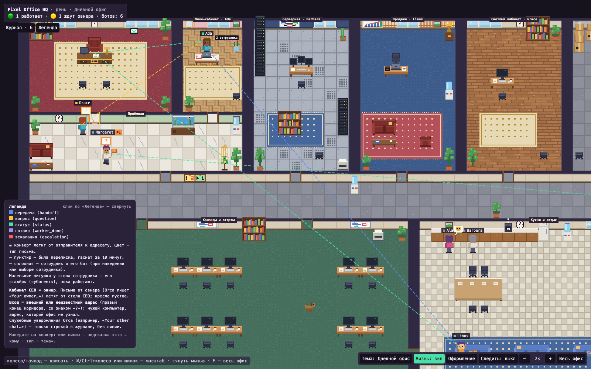
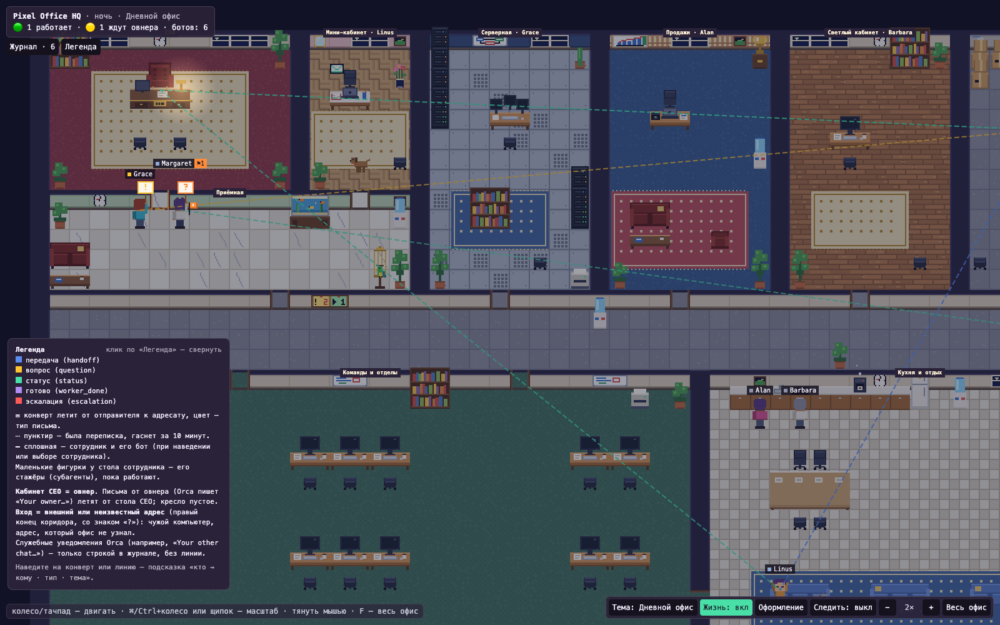

## v7.2: ночной свет

Овнер: «ночью офис темноватый… давай фонарей, торшеры, лампы, бра, пусть мониторы светятся, на кухне свечки, пусть
микроволновка светится, когда ей пользуются». Только графика и анимация, ноль токенов, обе темы.

- **Карта света, а не картинка лампы** (`plugin/engine/lights.ts`). Вечером и ночью офис темнеет (`PHASES.*.dark`), и
  каждый источник вырезает из темноты пятно мягкими пиксельными кольцами: клетка 2 × 2 пикселя арта, пять колец.
  Пятно ложится на пол и стены только своей комнаты (её прямоугольник со стенами; коридор — тоже комната), сквозь
  стену свет не идёт. Там, где светло, темнота не серая, а тёплая, цвета самого света; сверху тёплое свечение
  (`lighter`). Днём карты нет, лампы выключены и рисуются как обычные вещи.
- **Что светится над темнотой.** У каждой картинки две кисти: `p` — то, что освещает комната, и `g` — то, что светит
  само (абажур, пламя, экран). Ночью офис рисуется как обычно, сверху темнота с пятнами, потом ещё раз только пиксели
  `g`: они горят. Неподвижные (торшеры, бра, настольные лампы, лампа CEO, ночник) запекаются в один слой вместе с
  картой. Живые (пламя, гирлянда, неон, экраны, стойки, аквариум, техника) рисуются по одной на общем таймере. Если
  бот стоит перед светящейся вещью (сидит перед экраном, ждёт у микроволновки), он перерисовывается поверх уже
  затенённым по карте, только своими пикселями.
- **Где свет** (`office/map.json`): торшеры в проходах «Команд и отделов» и в коридоре, бра в коридоре, на стене
  команд, в кабинетах C-Level и в приёмной (два шара по бокам двери CEO), настольные лампы в двух кабинетах, лампа на
  столе CEO и два бра у часов в его кабинете, торшеры по углам. Кухня: торшеры у диванов, свечи на трёх столиках и на
  кухонном столе, гирлянда над столешницей, неоновая чашка, ночник-луна у лежанки кота. Плюс сами светятся аквариум и
  огоньки серверных стоек.
- **Экраны.** Пока бот или сотрудник работает за своим столом, экран светится на стол и на лицо и показывает живое: у
  CTO и в серверной — логи, у CSO/CFO/CMO и в продажах — графики, у ассистента — чат, у остальных — бегущий код
  (`workScreen`, `roomScreen`). Хозяин ушёл — скринсейвер (летающий логотип или звёзды); ничей стол — экран погашен.
  У стола, повёрнутого к нам, виден ноутбук: светится логотип на крышке цветом того, что на экране, а свет падает на
  лицо. Экраны живут и днём, но светят только вечером и ночью.
- **Техника по делу.** Новая вещь — микроволновка на столешнице. Микроволновка, кофемашина и холодильник «в деле»,
  когда бот стоит перед ними лицом к ним и не идёт (`appliancesInUse`). Тогда у микроволновки горит окно, крутится
  тарелка, она гудит (дрожит на пиксель, над ней волны); кофемашина подсвечивает дисплей и струю; холодильник
  открыт, внутри свет. «Жизнь» водит отдыхающих к микроволновке и холодильнику так же, как к кофемашине.
- **Свет — предметы «Оформления» и данные пакетов.** Торшер, бра, настольная лампа, свечи, гирлянда, неон, ночник —
  обычные типы мебели (`catalog.ts`) со встроенными видами. В «Оформлении» клик по лампе даёт сменить вид или
  выключить её; выключенные лежат в `decor.off` в хранилище плагина и остаются после перезапуска. Новый вид света —
  вариант в пакете скинов с полем `light` (цвет и радиус пятна): `office/skins/lights.json` («Ночной свет»), см.
  `docs/skin-packs.md#lights`.

**Производительность.** Карта света пересчитывается только при изменении ключа: фаза дня, тема, выбор в
«Оформлении», какие экраны горят, какая техника в деле (`LightCache`; в строке Shift+D — «карта света собрана N
раз»). Сборка всей карты — около 3 мс (87 источников, 136 тыс. клеток, node). Пламя, гирлянда, неон, экраны и
микроволновка берут кадр из общего таймера живности (5 Гц), своих таймеров нет. Бра запечены в стены (чанки) и
пересобираются, только когда лампы включили или выключили.

Замер ночью (`?hour=23`), демо-харнесс, Chrome без окна, окно 1600 × 1000, полная перерисовка на каждый кадр
анимации 4 с (FPS) и 300 кадров подряд (JS-время кадра); медиана трёх прогонов, «до» — сборка v7.1, «после» — v7.2:

| Вид, тема | FPS до → после | Кадр JS, мс, до → после | То же при CPU × 6 медленнее |
|---|---|---|---|
| Весь офис, «Дневной офис» | 60,1 → 60,1 | 0,28 → 0,49 | 1,67 → 5,16 (FPS 60,1 → 60,1) |
| Весь офис, «Тёмный лофт» | 60,1 → 60,3 | 0,31 → 0,55 | 1,65 → 4,15 (FPS 60,2 → 59,8) |
| «Команды и отделы» ×2 | 60,2 → 60,2 | 0,21 → 0,39 | 1,30 → 3,44 (FPS 60,4 → 60,2) |
| Кухня ×2,6 | 60,1 → 60,3 | 0,10 → 0,16 | 0,68 → 1,03 (FPS 60,3 → 60,3) |

Цена ночи — около 70 лишних `drawImage` на кадр всего офиса (новые лампы, свечи, экраны и их свечение); три
больших слоя (темнота, свечение, неподвижный свет) почти ничего не стоят. Кадр рисуется только при изменении
картинки (живность — 5 раз в секунду), так что в покое это доли процента времени.

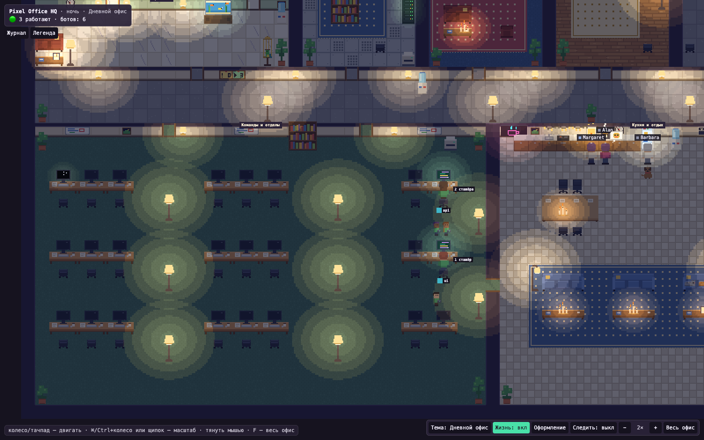
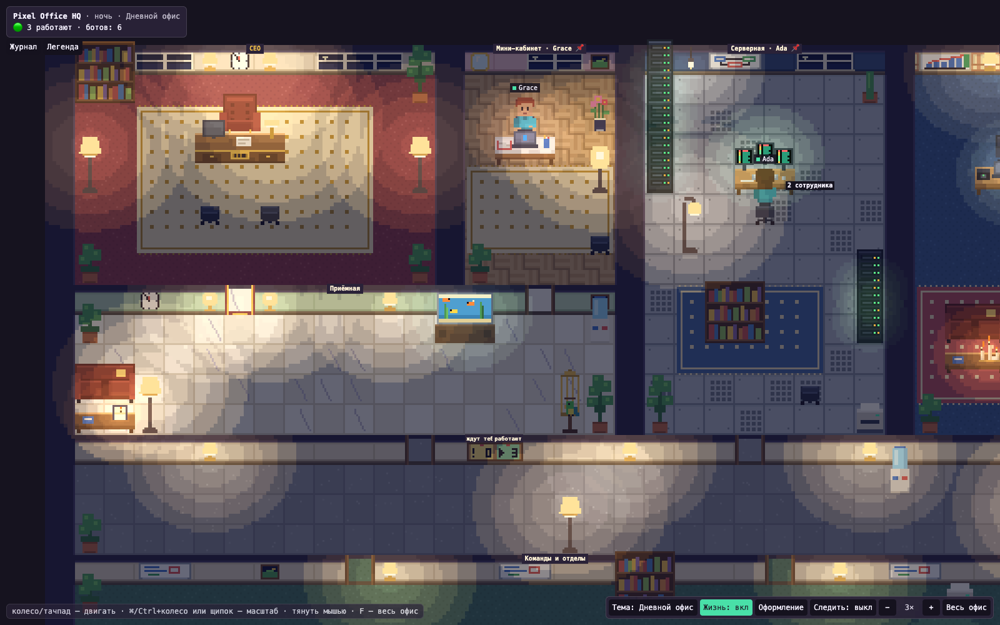
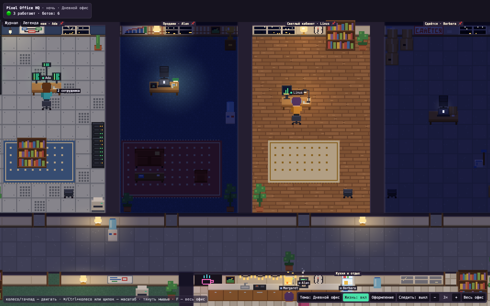
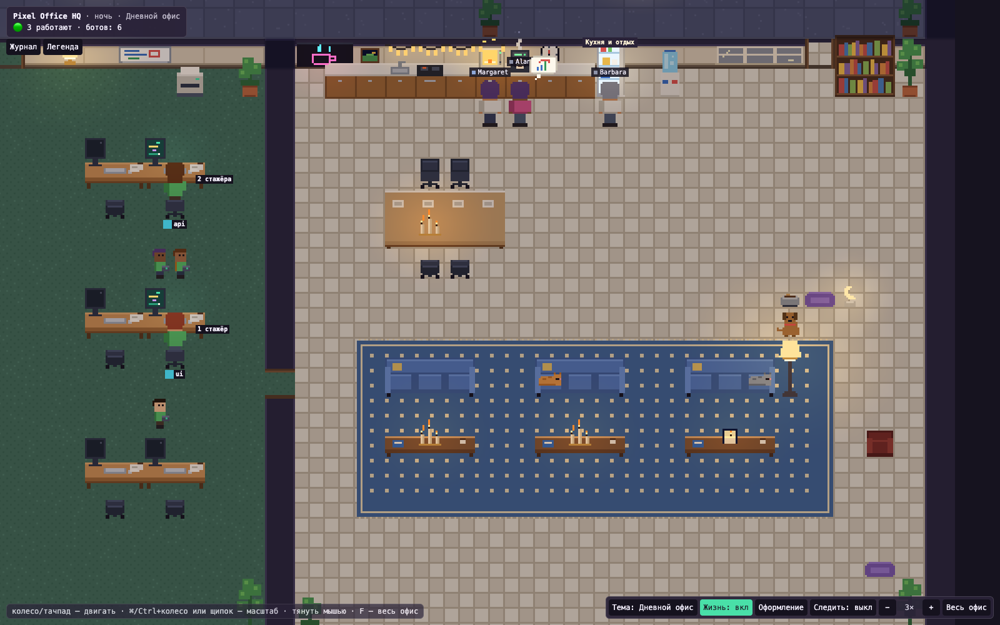
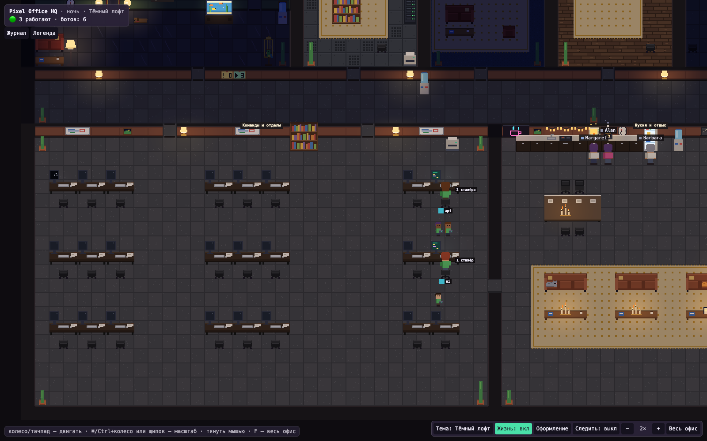
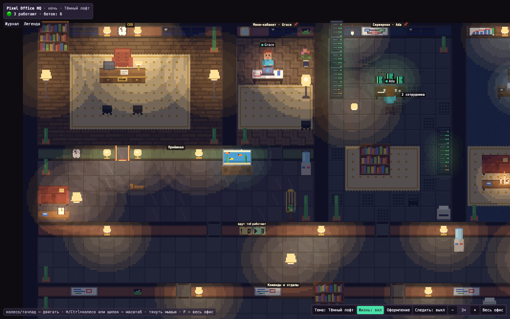
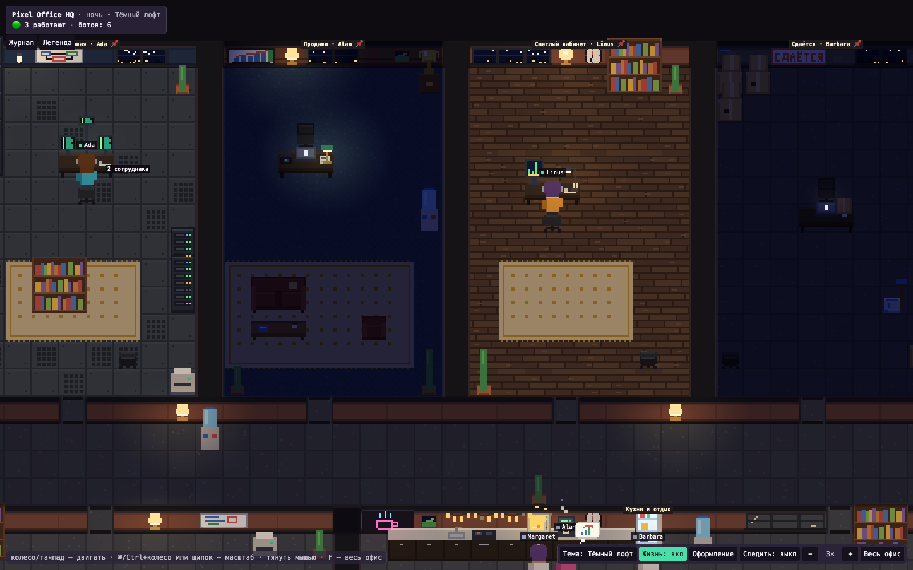
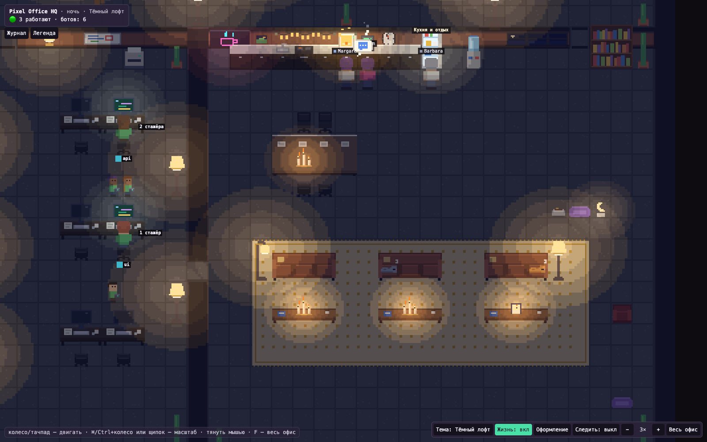
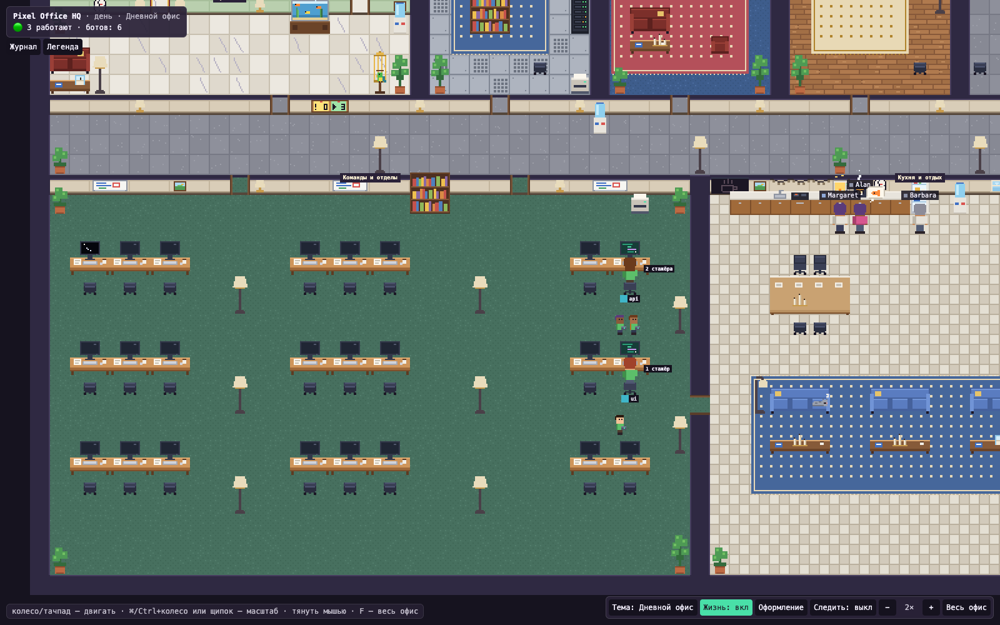
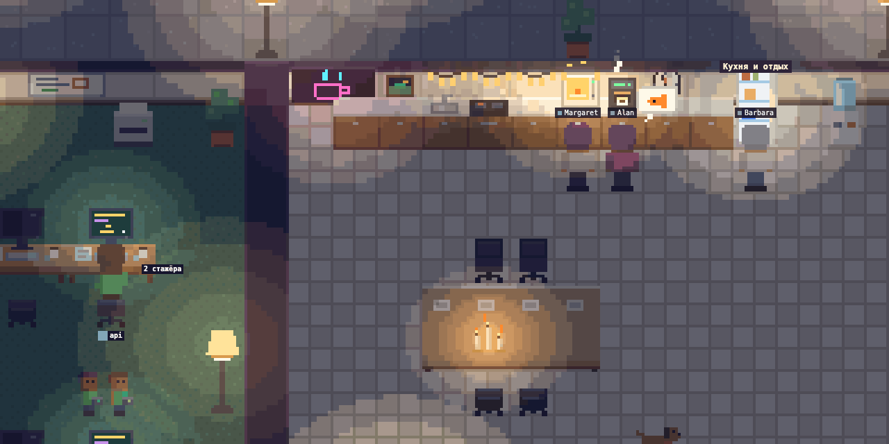

Темы «Ночной офис» нет: ночь в любой теме берётся из часов. Скриншоты — «Дневной офис» ночью и «Тёмный лофт» ночью,
демо-офис харнесса (`?hour=23`).

## v7.3: ночной свет по комнатам (переделка v7.2)

Овнеру не понравились круги света v7.2 («куча кругов, некрасиво») и ряды торшеров. Шли итерациями по его отзывам;
в итоге:

- **Ночь — равномерная холодная сине-фиолетовая.** Комната, где кто-то есть (бот, сотрудник, стажёр), «включает свет»:
  вся комната ровно, от стены до стены, свет плавно разгорается и гаснет за 0,7 с (`RoomLights`). Пустые комнаты
  тёмные, коридор освещён приглушённо и ровно.
- **Свет проявляет предметы, а не рисует дымку.** Одна карта света (клетка 2×2 пикселя арта) накладывается на
  кадр через `multiply`: в каждом канале множитель от ночного до тёплого почти дневного, никогда больше 1. Ночью
  ничто не светлее, чем днём, а под лампой видны настоящие цвета пола, мебели и людей. Комнаты и лампы складываются с
  насыщением, `1 − (1 − a)(1 − b)`, так что на пересечениях нет пересветов. Собственное свечение есть только у
  самого источника: абажур, пламя, экран, огни за окном.
- **Лампы светят вокруг себя, стены свет не пропускают.** Свет каждой лампы идёт обходом по тайлам от источника
  (`lightReach`): сквозь стену не проходит, через дверной проём проникает чуть-чуть (×0,35, дальше ×0,25). Внутри
  комнаты яркость плавно падает с расстоянием, между центрами тайлов коэффициенты смешиваются, ступенек нет. Радиусы:
  настольная лампа 42 px (стол и пара тайлов), бра 46 (стена и пол под ним), торшер у дивана 60 (диван и столик).
- **Расстановка как в настоящем офисе**, без рядов и сеток: торшеров на полу три (у CEO, в приёмной, у диванов на
  кухне), в «Командах» и коридоре только бра, настольные лампы на двух столах, свечи и гирлянда на кухне.
- **Экраны не закрыты головой.** У стола лицом вверх монитор стоит слева от головы, у `multi` два монитора по бокам и
  маленький сверху на стойке до стола (`HEAD_AT_DESK` в тестах).
- **Окна.** Наружные ночью тёмно-синие, со звёздами и городом. Город живёт: окна домов редко гаснут и загораются, у
  каждого свой период и фаза, звёзды слегка мигают, раз в 25–60 с проезжает машина, раз в 1–3 мин пролетает самолёт.
  Всё это — псевдослучай от зерна окна на общем таймере живности. Мебель перед окном (шкаф у CEO) закрывает огни:
  маска окна рисуется самим артом мебели (`windowCover`). Внутреннее окно (кухня → коридор) — просто стекло, за которым
  пол коридора. Какое окно какое, сказано в карте (`"view": "outside" | "inside"`); без поля определяется по тому,
  что за стеной.
- **Телепортация ботов**, которую видел овнер, — это не регрессия: офис загружен у овнера как dev-плагин из рабочей
  папки, и каждое сохранение файла перезапускает вкладку. При открытии боты по задумке встают на места без ходьбы.
  Без перезагрузок за 40 с было 704 движения, максимум 0,5 тайла за 50 мс, ни одного прыжка.

**Производительность** (ночь, демо-харнесс, Chrome без окна 1600 × 1000, медиана трёх прогонов; «Дневной офис» /
«Тёмный лофт»):

| Вид | Кадр JS, мс, v7.2 → v7.3 | При CPU × 6 медленнее, мс | FPS |
|---|---|---|---|
| Весь офис | 0,54 → 0,50 / 0,49 → 0,51 | 4,18 → 3,41 / 5,24 → 4,52 | 60 → 60 |
| «Команды и отделы» ×2 | 0,40 → 0,35 / 0,37 → 0,33 | 3,40 → 3,98 / 2,71 → 2,45 | 60 → 60 |
| Кухня ×2,6 | 0,16 → 0,14 / 0,15 → 0,16 | 1,22 → 1,10 / 0,99 → 1,10 | 60 → 60 |

Пересчёт только на изменение: свет ламп (обход по тайлам, все лампы) — ~2,4 мс, когда меняется лампа, экран или
техника в деле; сборка карты (комнаты и лампы вместе) — ~1 мс, когда меняется занятость комнаты и пока её свет
плавно разгорается (0,7 с). Город за окнами — несколько пикселей на кадр общего таймера.

## v7.4: бот «работает», только пока работает его чат

Баг: в Orca все чаты ботов были `done`, а в офисе боты сидели за столами со статусом «работает». Воркер прочитал
чаты ботов (`agents.list`) один раз при старте и дальше только дописывал их по событиям `agent.status.changed`.
Чаты из списка лежали под `sessionId` (а без него под номером `#i`), события — под `sessionId`, а без него под
`paneKey`. Когда ключи расходились, у чата появлялась вторая запись. Если «done» приходил под другим ключом или не
приходил вовсе, запись `working` оставалась навсегда. У трёх ботов офис держал 10, 4 и 8 «сессий» при 7, 2 и 2
чатах в Orca, и все были `done`.

Теперь снимок `agents.list` главный. На каждое событие бота его чаты читаются заново, и событие применяется только к
своему чату (по `sessionId`, иначе `terminalId`, иначе к единственному чату бота). Пока вкладка открыта, все боты
перечитываются раз в 30 с, вместе с опросом сотрудников и items. Бот работает, только если хотя бы один его чат
сейчас `working`; `blocked` и `waiting` — свои состояния. Сотрудники и стажёры на статус бота не влияют.

## Права плагина и почему

| Право | Зачем |
|---|---|
| `trusted-worker` | свой Node-процесс: видит всех ботов (вкладке Orca отдаёт только фокусный воркспейс), запускает read-only `orca` CLI |
| `workspace:read` | список воркспейсов: кто бот, где его дом |
| `agent:read` | статусы агентов и события их смены |
| `workspace:write` | открыть файл офиса командой «Open Pixel Office» и открыть дом бота (`workspace.open`) |
| `storage:own` | внешность ботов и выбранная тема (этап 4); столы воркеров (4b); закрепления овнера и места, которые боты заняли сами (v4); «Жизнь» вкл/выкл и «Оформление» (v5) |

Плюс read-only `orca` CLI ровно в восьми формах (см. «Доступ к Orca CLI»). Его разрешил CTO: в host API нет воркеров,
items, чатов и почты ботов.

## Невозможно в плагине и почему

- **Открыть конкретный чат.** Id чата есть в `orca bot chats`, но открыть чат по id API не умеет: `--chat`
  принимает только пишущая `orchestration send`. Кнопка открывает дом бота.
- **Заполнение контекста.** Не отдаётся ни в host API 1.10, ни в `orca` CLI. Перепроверено на этапе 4: у агентов в
  `worktree ps` нет полей контекста или токенов. Поэтому не рисуется.
- **Usage/токены.** Нужно право `history:read`, а оно открывает все транскрипты. Не включено решением CTO.
- **Время письма.** Orca отдаёт его только вместе с телом письма (`inbox --full`), тело мы не берём. Время в журнале
  — когда офис увидел письмо.
- **Кого ждёт бот.** У Orca 4 состояния, адресата ожидания среди них нет. `blocked`/`waiting` ведут к двери овнера.
- **Боты недоступных компьютеров** (другие компьютеры). `orca bot list` помечает их unreachable, `workspace.list` их не
  отдаёт.

## Локация = статус

Таблица — `ruleFor` в `plugin/engine/locations.ts`. Тест перебирает все 20 комбинаций «статус × Needs you ×
ошибка». Если у бота несколько чатов, берётся самый срочный: blocked > waiting > working > done. Бот без чатов
считается `idle`.

Порядок приоритетов: **working → стол в своём кабинете; blocked/waiting → в приёмную к двери CEO с «!»; Needs you →
туда же с «?»; done/idle → диван/кухня.** С v4 в кабинет CEO входят только через приёмную, места `owner-wait` стоят в
приёмной у его двери, и путь туда из коридора (BFS) идёт через дверь приёмной.

| Статус Orca | Needs you (items) | Последний ход с ошибкой | Куда идёт | Знак над ботом |
|---|---|---|---|---|
| `working` | любое | любое | за свой стол в своём кабинете (нет места → `standby`) | нет; новый ход снимает прежнюю ошибку |
| `blocked` (разрешение/approval) | любое | любое | в приёмную к двери CEO (`owner-wait`) | красный «!» |
| `waiting` (вопрос/ввод) | любое | любое | к двери CEO | жёлтый «!» |
| `done` / `idle` | есть | нет | к двери CEO | оранжевый «?» |
| `done` / `idle` | есть | да | к двери CEO | красный «!» (ошибка важнее «?») |
| `done` / `idle` | нет | да | диван / кухня | красный «!» |
| `done` | нет | нет | диван (переполнен → кухня → `standby`) | нет, сидит руки за головой |
| `idle` (чатов нет) | нет | нет | кухня (переполнена → диван → `standby`) | нет, стоит с кружкой |

- **Ошибка** — `mainAgent.outcome: "failure"` в событии `agent.status.changed`. `agents.list` исход не отдаёт,
  поэтому после перезапуска воркера плагина прежняя ошибка не видна, пока бот не сделает следующий ход.
- **Needs you** — `counts.needs_you` из `orca bot item list` (обновляется раз в 30 с или по событию).

Чего Orca не различает (и мы не выдумываем):

- **Кого ждёт агент.** В Orca 4 состояния: working/blocked/waiting/done. Отличить «ждёт овнера» от «ждёт другого
  бота» нельзя, поэтому и `blocked`, и `waiting` идут к двери овнера.
- **Время письма без его тела** — см. «Источник событий».

Бот сохраняет своё место на диване или у двери, пока его статус не изменится. Поэтому, когда уходит сосед,
остальные не пересаживаются.

## Карта: `plugin/office/map.json`

Новая комната или отдел добавляется правкой JSON, код менять не нужно. Ошибки показываются во вкладке списком с
местом, например:
`stamps.lounge.furniture[3]: неизвестный тип мебели "sofaa"` или
`plan.doors[2]: дверь (0,2) никуда не ведёт`.

```jsonc
{
  "version": 1,
  "name": "Pixel Office HQ",
  "stamps": {                       // штампы комнат: шаблоны, которые план ставит в нужные места
    "ceo": {
      "kind": "owner",              // owner | reception | clevel | specialists | team | lounge | corridor | other
      // "forRole": "QA",           // необязательно: комната для роли; её столы первыми достаются боту [QA]
      "wall": "plain",              // plain | navy | stripes | rose | sage | bare — грань верхней стены
      "label": "CEO",               // табличка на стене
      "w": 14, "h": 12,             // в тайлах, включая стены по периметру
      "floor": "carpet-red",        // wood | parquet | carpet-red | carpet-blue | carpet-green | tile | concrete | marble | raised
      "furniture": [                // координаты внутри штампа: (0,0) — левый верхний угол стены
        { "type": "window", "x": 2, "y": 0, "w": 3 },       // на стене: только y = 0
        { "type": "ceo-desk", "x": 5, "y": 4 },
        { "type": "desk", "id": "desk", "x": 2, "y": 4, "facing": "up", "variant": "multi" }
      ],
      "spots": [ { "kind": "kitchen", "x": 3, "y": 2, "facing": "up" } ]   // kitchen | standby | owner-wait
    }
  },
  "plan": {
    "rooms":     [ { "id": "ceo", "stamp": "ceo", "x": 0, "y": 0, "label": "можно переопределить" } ],
    "corridors": [ { "id": "hall", "x": 0, "y": 11, "w": 56, "h": 5, "floor": "concrete", "furniture": [] } ],
    "doors":     [ { "x": 6, "y": 8, "owner": true } ],    // в стене, пол по обе стороны; ровно одна дверь — "owner"
    "spots":     [ { "kind": "owner-wait", "x": 5, "y": 9, "facing": "up" } ]    // абсолютные координаты
  }
}
```

Правила, которые проверяет валидатор (`plugin/engine/world.ts`):

- Соседние комнаты могут делить одну стену, но не могут заходить друг другу внутрь.
- Дверь стоит на стене, по обе стороны от неё пол.
- Мебель стоит на полу своей комнаты и не налезает на другую мебель.
- У стола (`desk`) есть место для стула: снизу для `facing: "up"`, сверху для `"down"`.
- id столов уникальны. Полный id стола: `<комната>.<id>`, например `office-1.desk`.
- Обязательны: кабинет `owner`, дверь `owner: true`, хотя бы одно место `owner-wait`, хотя бы один стол и диван или
  кухня.
- До каждого стула и места можно дойти от двери овнера (проверка BFS).
- Здание не больше 256×256 тайлов.

Мебель (`plugin/engine/catalog.ts`):

- Рабочие места: `desk` (2×1, стол бота; варианты `multi` — три монитора, `phone` — телефон, `tidy` — ежедневник,
  `boxed` — коробка на углу), `ceo-desk`, `chair`, `armchair`.
- Столы и мягкая мебель: `sofa` (w×1, по месту на тайл — сюда садятся закончившие), `loveseat` (диванчик для
  гостей, декор), `coffee-table`, `kitchen-table`.
- Кухня: `counter`, `sink`, `stove`, `coffee-machine` (пар), `fridge`, `water-cooler` (иногда булькает).
- Прочее на полу: `printer`, `plant`, `big-plant`, `bookshelf`, `rug` (w×h, варианты `red`/`blue`/`cream`),
  `server-rack` (мигает), `trophy`, `flowers`, `boxes`, `ladder`, `paint`, `aquarium` (2×1, рыбки), `pet-bed` (кот).
- На стене: `window`, `whiteboard` (вариант `arch` — схема архитектуры), `tv`, `clock` (стрелки — реальное время),
  `picture`, `mirror`, `chart` (плакат с графиком продаж, данных не показывает), `sign` («СДАЁТСЯ»),
  `notice-board` (реальные числа, см. «v4»).

Чтобы добавить отдел:

1. Добавьте штамп в `stamps`.
2. Поставьте его в `plan.rooms`.
3. Добавьте дверь в `plan.doors`.
4. При необходимости расширьте коридор.
5. Откройте вкладку заново.

Пример есть в тесте `a new room is a JSON edit only`.

## Рассадка: случайно, но стабильно; закрепляет овнер

Файла рассадки больше нет: никто не зашит ни за каким кабинетом. Места описывает сама карта.

- **Места ботов** — столы в комнатах `kind: "clevel"` (кабинеты C-Level, мини-кабинет в приёмной, «Предбанник QA → CTO»;
  в каждом ровно один стол, поэтому в кабинете один бот) и в комнатах `kind: "specialists"` (open-space «Специалисты»
  на месте «Сдаётся»: четыре места для ботов ниже C-level — юрист, таргетолог…; табличка «Свободно» на пустом).
- **Место по роли** — комната может объявить роль (`"forRole": "QA"` у штампа или у комнаты плана), стол — свою
  (`"role"`). Роль бота — префикс его имени (`[QA] Тестер` → `QA`), без учёта регистра. Ключа бота в карте нет.
  «Предбанник» объявлен для QA: кабинет CTO стоит в глубине Серверной, своей двери в коридор у него нет, путь к его
  стулу идёт только через предбанник.
- **Места воркеров** — столы «Команд и отделов» (`teams`), см. этап 4b.
- **Ключ бота** — имя папки его дома `~/.orca/bots/<slug>`: `cto` = Ада, `seller` = Лео, `bot-2` = Грейс. Для
  бота на другом хосте к ключу добавляется хост: `ssh:devbox/<slug>`.

Порядок для бота (`assignBotSeats` в `plugin/engine/seating.ts`):

1. **Закрепление овнера** (storage, ключ `pins`) — всегда важнее всего.
2. **Свободное место, объявленное под роль бота** — важнее памяти: бот [QA], которого раньше посадило в Светлый
   кабинет, сам перейдёт в предбанник.
3. **Место, которое бот уже занял сам** (storage, ключ `botSeats`), если это место бота, оно свободно и не объявлено под
   другую роль.
4. **Свободный кабинет, выбранный случайно** (`Math.random`), а кабинетов нет — свободное место в open-space
   «Специалисты»; места под чужую роль бот не занимает. Выбор сразу сохраняется в `botSeats`, поэтому после перезапуска
   плагина или Orca бот сидит там же и не прыгает.
5. Мест ботов не осталось — первый свободный стол в «Командах»; нет и его — бот стоит на `standby`.

Бот, которого сейчас нет в офисе, сохраняет своё место в памяти, пока его никто не занял. Пока storage не прочитан,
вкладка никого не рассаживает (иначе бот получил бы новое случайное место раньше, чем прочиталось старое).
Без storage места держатся до закрытия вкладки, панель об этом пишет.

### Закрепление из интерфейса

- Клик по боту (или воркеру) → в панели блок **«Место»**: где сидит, «📌 закреплён овнером» или «авто», кнопки
  **«📌 Закрепить…»** и **«Открепить»**.
- «Закрепить…» включает выбор места: в панели список кабинетов (для воркера — столов «Команд») с пометками «свободен»,
  «занят: Имя 📌», «сейчас здесь», а на карте эти места обведены (зелёный — свободно, жёлтый — занято, голубой —
  своё). Выбрать можно в списке или **кликом по кабинету/столу на карте**. Esc или «Отмена» — выйти.
- **В кабинете один бот.** Если выбранный кабинет занят, панель предлагает **«Поменяться местами»**: бот занимает
  кабинет, а сидевший там пересаживается на его прежнее место и закрепляется там. Если у бота места не было, второй
  возвращается к авто-рассадке. Для столов воркеров так же.
- **«Открепить»** возвращает к авто-рассадке. Бот остаётся, где сидел (это его запомненное место), пока его не
  займёт закреплённый.
- Закрепления живут в `orca.storage` (`pins`: `{ v: 1, bots: { <ключ>: <стол> }, workers: { <id воркспейса>: <стол> } }`)
  и переживают перезапуск плагина и Orca. Две открытые вкладки офиса узнают о закреплении друг друга через
  `storage.onDidChange`.
- Над кабинетом подпись «Кабинет · Имя 📌» (вблизи) или просто имя (издалека), свободный — «· свободен».

## Как устроено

```
plugin/
  orca-plugin.json      trusted-worker; customEditors + newFiles (.pixel), команда, статус-бар, события
  office/map.json       здание: штампы комнат, план, коридоры, двери, мебель, места
  office/skins/         пакеты скинов: index.json + по файлу на пакет (темы и варианты)
  src/bots.ts           кто бот, ключ, имя/роль, статус стола (самый срочный чат), агент
  src/worker.ts         воркер: workspace.list → боты → agents.list; события agent.status.changed; статус-бар; команда
  src/protocol.ts       контракт вкладка ↔ воркер
  src/cli.ts            белый список read-only команд orca CLI и их запуск (execFile, таймаут)
  src/extras.ts         разбор ответов CLI: воркеры, items, текущий чат; политика опроса
  src/mail.ts           почта между ботами: разбор inbox без тел, адрес → бот/сотрудник/овнер/вход, опрос
  engine/               чистая логика, без DOM (вся покрыта тестами)
    catalog.ts          виды пола, мебели, комнат, мест
    world.ts            разбор и проверка map.json → сетка тайлов, столы, места
    path.ts             BFS
    seating.ts          места ботов: закрепления овнера, случайная стабильная рассадка, обмен местами
    cat.ts              офисный кот: где он сейчас, только по часам и BFS
    life.ts             «Жизнь»: рутины отдыхающих и ждущих, облачка болтовни (без LLM)
    locations.ts        STATUS_PLACE (статус → место) и планировщик целей
    actors.ts           боты на карте: путь, шаги, кадры
    camera.ts           камера: пан, зум к точке, fit, границы
    scheduler.ts        dirty-флаг, один таймер ~12 Гц, видимые чанки
    fx.ts               конверты, линии с затуханием, появление/бледнение/уход сотрудников
    follow.ts           «Следить»: плавная камера и перехват ввода
    lights.ts           ночной свет: источники, экраны, техника в деле, карта света и её кэш
  editor/
    palette.ts          единая палитра
    art.ts              весь пиксель-арт (рисует через Paint, тестируется попиксельно)
    render.ts           кадр: чанки, спрайты по глубине, бейджи, таблички
    panel.ts            модель и HTML панели бота и редактора внешности
    appearance.ts       внешность бота: пресеты, проверка, хранение в orca.storage
    theme.ts            тема офиса: раздел theme пакета скинов
    skins.ts            пакеты скинов: разбор, проверка, варианты, выбор овнера («Оформление»)
    daylight.ts         фазы дня по часам: небо, тон, темнота и свет
    lamps.ts            картинки света: лампы, свечи, гирлянда, неон, ночник, микроволновка, экраны
    main.ts             вкладка: загрузка карты, ввод, HUD, подсказка, панель, опрос «экстра»
tools/harness/          офис вне Orca для проверки (заглушка orca + снимок реального ответа воркера)
docs/orca-api-inventory.md   разведка API для этапов 2–4
```

**Данные.**

- Боты: folder-воркспейсы `…/.orca/bots/<slug>`, список не зашит.
- Состояние держит только trusted-worker: при старте `workspace.list` и `agents.list({workspaceId})`, дальше события
  `agent.status.changed`.
- Вкладка запрашивает `office.desks` один раз и потом слушает посты воркера.
- Воркеры, items и чат — см. «Доступ к Orca CLI». Единственный опрос — раз в 30 с из открытой вкладки.
- Карту и рассадку вкладка читает из файлов плагина (`fetch` относительно модуля).

## Данные Orca

Полная таблица «фича → источник → доступно ли → как проверил» лежит в
[`orca-api-inventory.md`](orca-api-inventory.md).

## Ограничения

- **Боты других компьютеров.** Боты других компьютеров сейчас **не видны**: `orca bot list` помечает их unreachable, и
  `workspace.list` их не отдаёт. Бот доступного SSH-хоста попадёт в офис, если его дом тоже
  `…/.orca/bots/<slug>`; его ключ — `<hostId>/<slug>`.
- **Стол (поза и место бота) показывает только чаты самого бота.** Воркеры видны сотрудниками рядом со столом и в
  панели. У бота без своего стола (все заняты) сотрудники не рисуются, только в панели.
- **Задержка «экстра».** Воркеры и items обновляются по событию агента (через 3–10 с) или раз в 30 с. Если CLI
  недоступен, в панели «нет данных» и причина в подвале панели.
- **«Открыть бота в Orca»** показывает дом бота, а не конкретный чат: API не умеет открывать чат по id.
- **Закрытая сессия бота** уходит только при следующем пересканировании: создание или удаление воркспейса либо
  перезапуск воркера.
- **Правки `map.json`** видны после переоткрытия вкладки (или `orca plugin dev reload`).
- **Шрифт.** Таблички и бейджи — системный моноширинный шрифт; пиксельный только рисунок.
- **Масштаб только целый.** В узком окне «весь офис» может быть мелковат, это цена чётких пикселей.
- **Новые права и команды** меняют fingerprint: одобрение через CTO.

## Не делаем и почему

- **Свободные разговоры ботов друг с другом, «кухонные» беседы, митинги без повестки.** Исследования мультиагентных
  систем показывают, что такие разговоры зацикливаются, агенты подстраиваются друг под друга и повторяют роли.
  Пользы нет, а токены тратятся.
- **LLM-реплики «для красоты», болтовня в пузырях.** Ноль токенов на атмосферу: на экране только то, что сообщает Orca.
- **Автономное поведение агентов в офисе:** блуждание, «обед», «перекур». Бот двигается, только когда меняется его
  реальный статус. Всё остальное было бы враньём.
- **Бот-начальник, раздающий задачи.** Задачи ставит овнер и его C-level через Orca, офис только показывает.
- **Питомцы с LLM и любые фичи, которые жгут токены без результата.**

Возможно позже, **только по решению овнера**: структурированный обмен знаниями с повесткой и записью итога в общую
память.

## Авторство, лицензии, референсы

Весь код и весь арт этого плагина написаны с нуля. Чужой код и чужие спрайты не копировались, никакой
репозиторий-референс не клонировался и не запускался. Из перечисленных в задаче проектов с лицензиями MIT/Apache
взяты **только идеи**:

- Oddboro (New-Altitude/Oddboro): здание из JSON-штампов комнат и плана, отрисовка только при изменениях, отсечение
  чанками 16×16, один таймер анимаций ~12 Гц, «локация = статус».
- pixel-agents (pixel-agents-hq/pixel-agents), openclaw-pixel-agents (SweetSophia/openclaw-pixel-agents): тайловая
  карта, BFS, зум и пан.
- cubicle (caglarutkuguler/cubicle): палитра одним файлом, стол владельца.

Проекты под AGPL, с некоммерческой лицензией или без лицензии не использовались ни как код, ни как арт.

## Разработка

```sh
cd plugin
orca plugin test . --json && orca plugin check . --json
npx -p typescript@5 tsc -p . --noEmit
orca plugin dev reload .                      # после правок (одобрение папки уже есть)
orca plugin shot . --editor templates/office.pixel --width 1600 --height 1000 --json
orca plugin dev request . office.desks        # что видит вкладка
../tools/harness/build.sh /tmp/po-harness     # офис вне Orca: http://127.0.0.1:18765/
```
