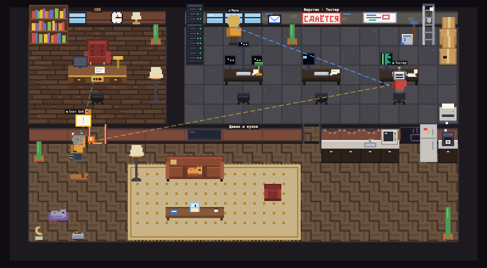
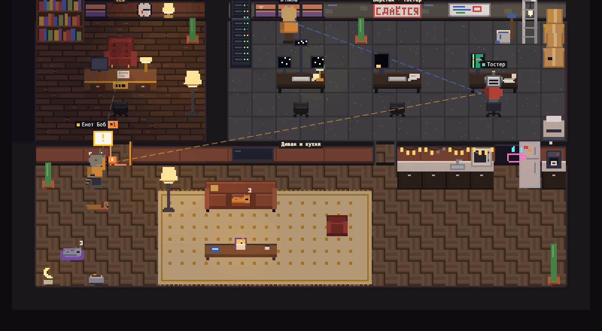
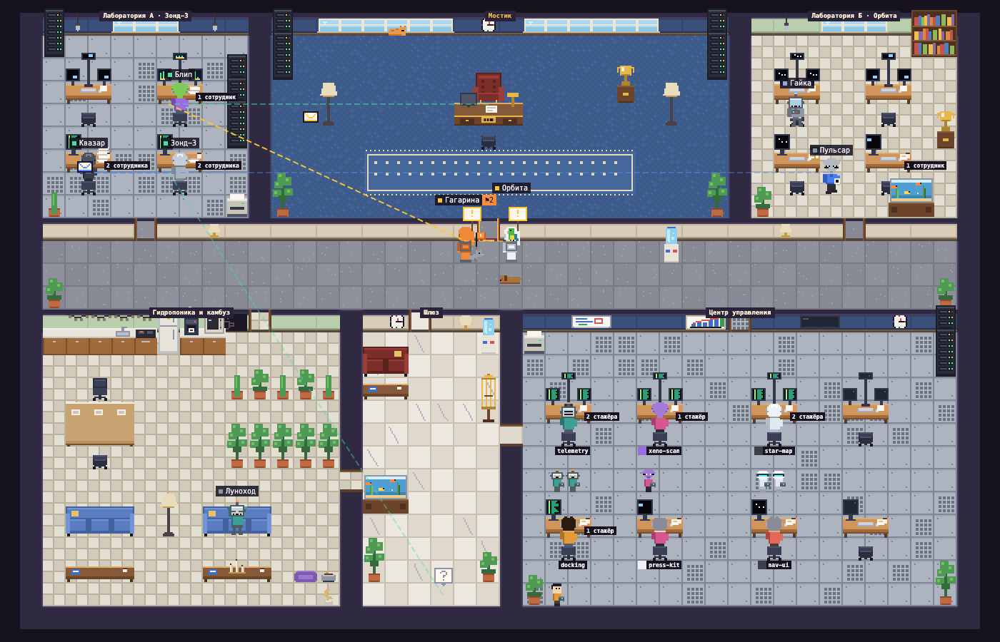
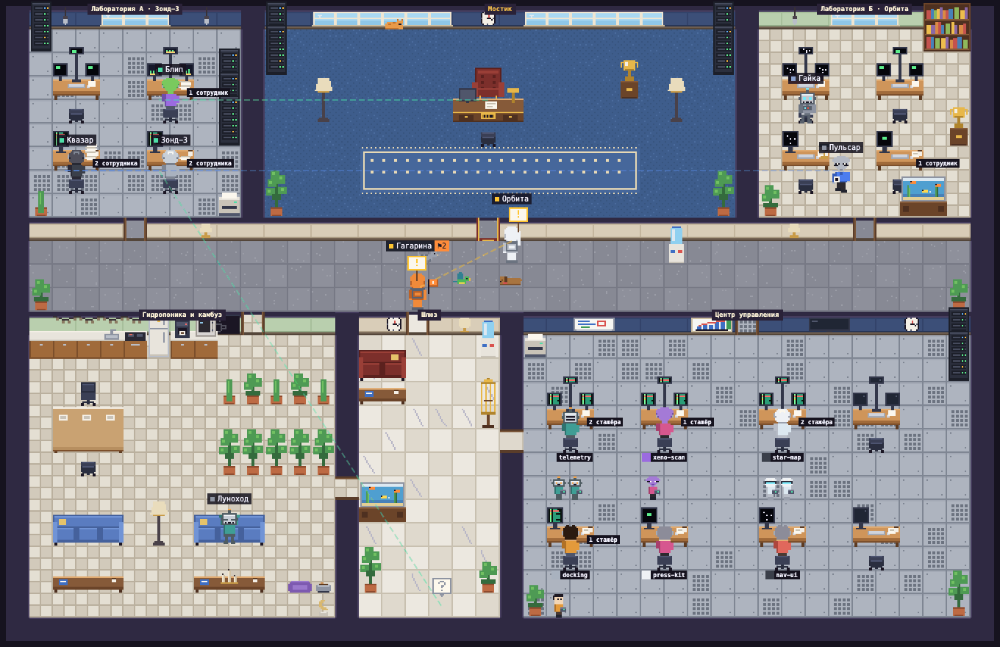
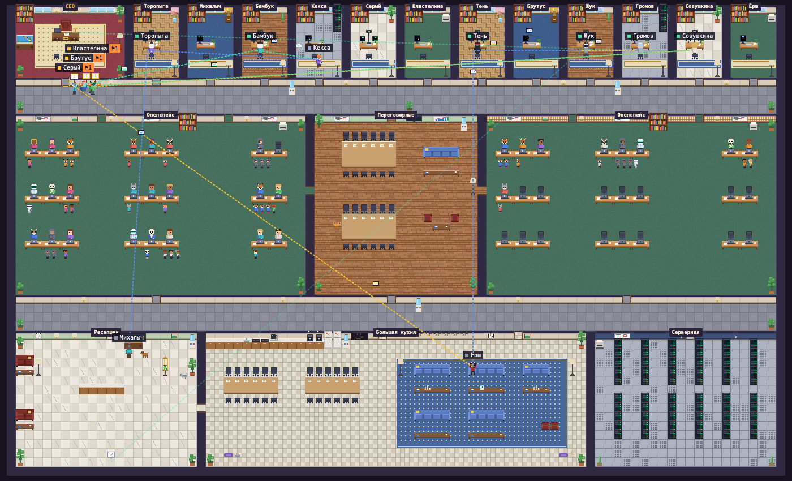
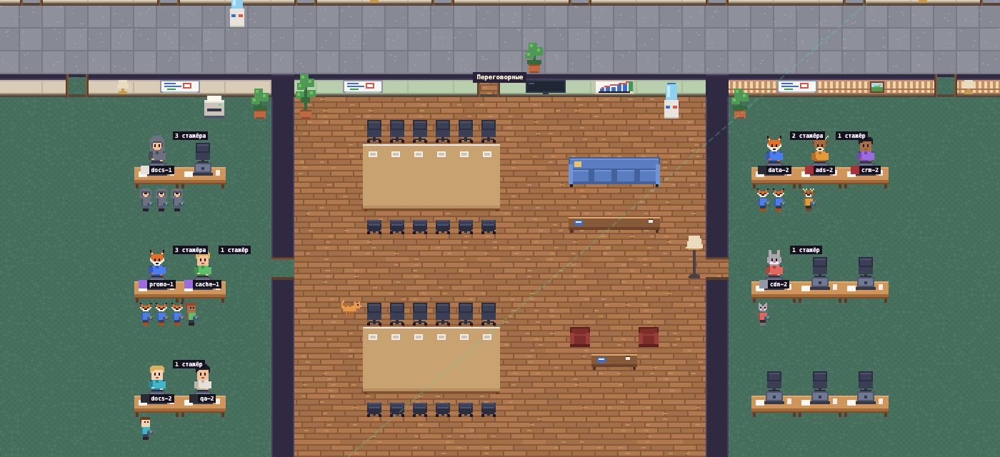

# Example offices

Four buildings in the same format as the shipped `plugin/office/map.json`, each with made-up bots for the
screenshots. Nothing here is real: names, mail and states are invented (`demo.json`).

| Office | Bots | Workers | Interns | Theme | Who works there |
|---|---|---|---|---|---|
| [garage](garage/) — a startup in a garage | 3 | — | — | Тёмный лофт | a retro robot, a raccoon, a human; a cat on the sofa |
| [station](station/) — an orbital station, the CEO's bridge in the middle | 8 | 6 | 6 | Дневной офис | androids, astronauts, aliens, robots; a parrot in the airlock |
| [corp](corp/) — a corporation: 12 executives, two open spaces, meeting rooms, a big kitchen | 12 | 36 | 36 | Дневной офис | fox, knight, android, panda, ninja, pirate, wolf…; a dog, a cat and a parrot |
| [castle](castle/) — a throne room, a library, barracks and a feast hall | 4 | 5 | 6 | Тёмный лофт | knights, a skeleton, a wizard, a pirate jester; a dog and a parrot |

**Garage**, a small office: three bots, a workbench, a sofa and a cat.




**Orbital station**, medium: two labs on both sides of the CEO's bridge, mission control for the workers, a hydroponic galley.




**Corporation**, large: 12 executives, 36 employees with their interns, a queue of «Needs you» at the CEO's door, mail everywhere.




More: [garage at night](garage/night.png), [station at night](station/night.png), [the bridge](station/bridge.png),
[corporation at night](corp/night.png), [the CEO's door](corp/ceo-door.png), [the kitchen at night](corp/kitchen-night.png),
[castle at night](castle/night.png), [castle by day](castle/day.png).

## Use one in your office

1. Copy the map over the shipped one: `cp examples/offices/station/map.json plugin/office/map.json`.
2. Reinstall or reload the plugin (`orca plugin dev load ./plugin` for a dev copy) and open the office.
3. Your own bots take the desks: a bot sits in a room of kind `clevel`, its workers at the desks of any room of kind
   `team`. Theme, animals and each bot's look are yours to pick in the office (**Тема**, **Оформление**); `demo.json`
   lists what the screenshots use.

Your pins and places are kept per desk id: after changing the map, bots whose desks are gone simply take new ones.

## See them without Orca

```sh
tools/examples/build.sh /tmp/po-examples     # then open http://127.0.0.1:18768/<name>/?fresh  (?hour=23 for the night)
```

The harness serves each example with its `demo.json`: made-up bots and workers, mail, the theme, animals and looks
(as the plugin storage to start with). To make your own: edit `tools/examples/make-offices.mjs` and run it, or write
`map.json` by hand; `plugin/engine/examples.test.ts` checks that every example loads without errors.

The screenshots and GIFs come from `tools/examples/shoot.mjs` (Playwright, a fake clock, scripted mail and statuses):

```sh
node tools/examples/shoot.mjs http://127.0.0.1:18768 /tmp/po-shots            # or: … garage corp:ceo
ffmpeg -framerate 10 -i /tmp/po-shots/garage-gif/f%04d.png -filter_complex \
  "split[a][b];[a]palettegen=max_colors=256:stats_mode=full[p];[b][p]paletteuse=dither=none:diff_mode=rectangle" garage.gif
```
